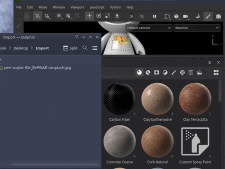
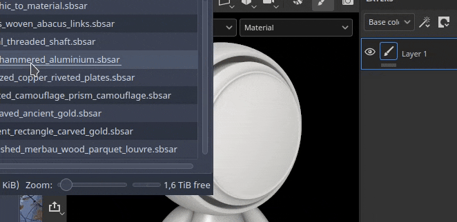
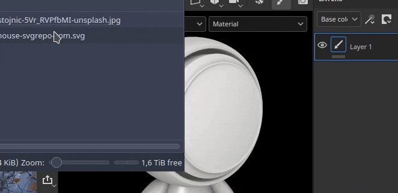
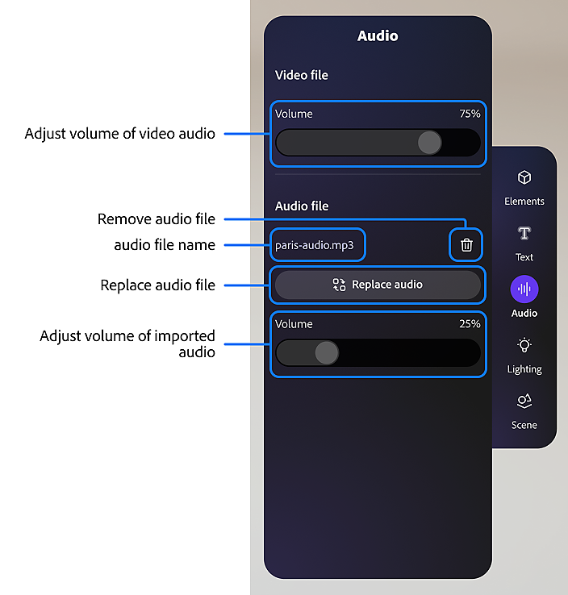
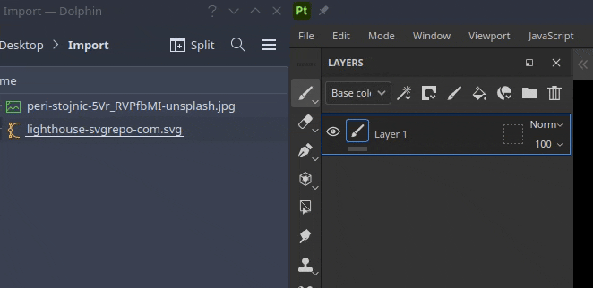
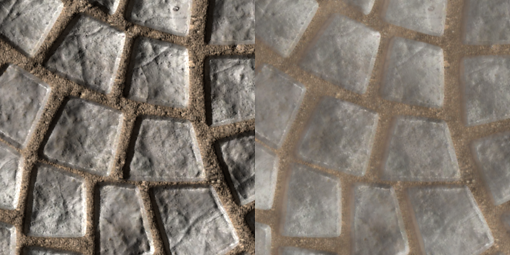
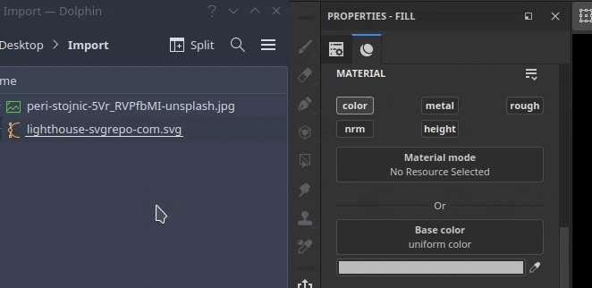

# ドラッグ&amp;ドロップによるリソースの追加

リソースの読み込みは、アプリケーションの外部からインターフェイスの別の領域にファイルをドラッグ&amp;ドロップするだけで簡単に実行できます。

## 「アセット」ウィンドウへのインポート

Painterにリソースを読み込むには、「アセット」ウィンドウにリソースをドラッグ&amp;ドロップします。

「リソースをインポート」ウィンドウが開き、リソースを置く場所（プロジェクト内、プロジェクト間で再利用するディスク上、または一時的に使用するセッション内）を制御できます。 このウィンドウでは、リソースの使用方法を適切に設定することもできます。一部のファイル形式があいまいな場合があるためです。

### ビューポートへの読み込み

マテリアルをプロジェクトに直接読み込んで適用するには、アセットをビューポートにドラッグ&amp;ドロップします。 ファイルのドラッグ中は、メッシュをハイライトして、プロジェクトのどの部分に適用されるかを示す必要があります。

SVGファイルをビューポートにドラッグ&amp;ドロップして読み込むこともできます。 その場合は、ワープ投影モードと<b>グラフィックをマテリアルに変換</b>して新しいレイヤーが作成されるので、デカールを作成するのに便利です。

### レイヤースタックへの読み込み

リソースをレイヤーにドラッグ&amp;ドロップすると、ドロップ時にレイヤー（またはエフェクト）が作成されます。 リソースがSubstanceのマテリアルまたはフィルターでない場合は、どのチャンネルにリソースを配置するかを確認するメニューが表示されることがあります。

<table>
<tr style="border: 0;">
<td style="border: 0;" valign="top">

<b>オーディオ</b>

プロジェクトに音声を調整または追加します。

* オーディオがある場合は、ソースビデオのボリュームを調整します。
* 外部オーディオファイルを追加、削除、または置換します。
* 外部オーディオファイルのボリュームを調整します。

</td>
<td style="border: 0;" valign="top">

</td>
</tr>
</table>

### リソーススロットへのインポート

ファイルをインターフェイスのリソーススロットの1つにドラッグ&amp;ドロップすると（たとえば、塗りつぶしレイヤー内のチャンネルにファイルをドラッグ&amp;ドロップすると）、リソースが読み込まれ、自動的に適用されます。

