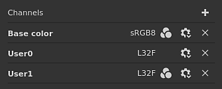
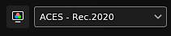
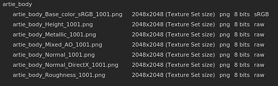
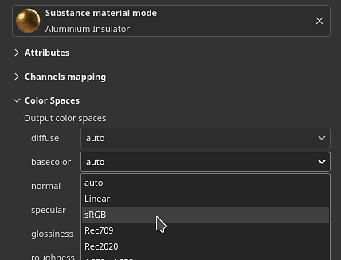
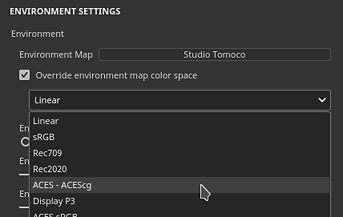

# カラーマネジメント

カラーマネジメントとは、カラーを処理および変換することです。 リソースの読み込みから画面上でのカラー表示、最後にテクスチャの書き出しまで。 色校正は、アプリケーション間で同じ外観を保つために重要です。

アプリケーションのカラーマネジメントは、[OpenColorIO](https://opencolorio.org/) （OCIO略版）バージョン2の統合によって処理されます。 OCIOは、カラーを変換して表示するための、フィルムおよびアニメーションの標準ツールです。 カラーマネジメントを有効にするには、新しいプロジェクトを作成するか、既存のプロジェクトを開き、専用の設定を有効にします。

>[!NOTE]
>
> カラーマネジメントは、バージョン7.4.0以降で利用できます。

## プロジェクト設定

カラーマネジメント設定：

* [ACEを使用したカラーマネジメント – ICC](color-management-with-adobe-ace-icc.md)
* [OpenColorIOでのカラーマネジメント](color-management-with-opencolorio.md)

## 語彙

関連するワークフローを理解するために、カラーマネジメントに関するいくつかの専門用語を知っていると役立つ場合があります。

| キーワード | 説明 |
| --- | --- |
| **カラースペース** | カラーが定義される座標系。 |
| **作業用スペース** | テクスチャやペイントなどをブレンドするためにアプリケーション内で使用されるカラースペース。 |
| **表示変形** | 表示変形では、リニアカラーを作業用スペースからモニターのカラースペースに変換して、人間の目に見える知覚的にカラーを表示します。 多くの場合、表示変形にはトーンマッピングパスが含まれ、画面で許可される値の制限範囲に合わせてカラーを圧縮します。 |
| **構成** | OCIO設定ファイル。 作業用スペース、カラースペースの一覧、および表示変形の一覧を定義します。 |
| **ACE** | ACEはAcademy Color Encoding Systemの略で、デジタルイメージファイルを交換するための多くのアプリケーションの標準です。 デフォルトでは、この標準の2つのバージョンがアプリケーション内に含まれています。 |
| **トーンマッピング** | これは、HDR(ハイダイナミックレンジ)からLDR（低ダイナミックレンジ）にカラー値をマッピングするプロセスです。 この処理により、表示される色の範囲が広くなります。 |

## カラーマネジメントチャンネルのリスト

アプリケーション内では、どのチャンネルをカラーマネジメントするかにかかわらず（データ/パススルー）、事前に定義されています。

| チャンネル | カラーマネジメント |
| --- | --- |
| **Ambient occlusion** | いいえ |
| **アニストトロピー角** | いいえ |
| **Anisotropy level** | いいえ |
| **Base color** | **はい** |
| **Blending mask** | いいえ |
| **Coat color** | **はい** |
| **Coat normal** | いいえ |
| **Coat opacity** | いいえ |
| **Coat roughness** | いいえ |
| **Coat specular level** | いいえ |
| **Diffuse** | **はい** |
| **ディスプレイスメント** | いいえ |
| **光沢度** | いいえ |
| **Height** | いいえ |
| **Ior** | いいえ |
| **メタリック** | いいえ |
| **標準** | いいえ |
| **不透明度** | いいえ |
| **リフレクション** | いいえ |
| **ラフネス** | いいえ |
| **散布** | いいえ |
| **拡散カラー** | **はい** |
| **光沢カラー** | **はい** |
| **光沢の不透明度** | いいえ |
| **ラフネス** | いいえ |
| **Specular** | **はい** |
| **Specular edge color** | **はい** |
| **Specular level** | いいえ |
| **Translucency** | いいえ |
| **Transmissive** | **はい** |
| **ユーザーX (0-15)** | [テクスチャセットの設定](../../interface/texture-set/texture-set-settings.md)に依存しています。 デフォルトでは、ユーザーチャンネルはカラーマネジメントされません。 

 |

## カラーピッカー

カラーマネジメントが有効になっている場合、[カラーピッカー](../../interface/color-picker.md)の動作がわずかに変わります。

* カラーは、選択した現在の表示に基づいて編集されます。
* いくつかの追加情報がインターフェイスに追加されました。

詳しくは、カラーピッカー[ドキュメントページ](../../interface/color-picker.md)を参照してください。

## ビューポートコントロール

2Dビューと3Dビューはどちらもカラーマネジメントされており、ビューポートの上部にある専用の設定を使用して、使用する表示変形を制御できます。

* **左ボタン**: ビューポートの表示変形を有効または無効にします。 無効にすると、ビューポートのカラーがraw/passthroughとして表示されます。 このボタンはデフォルトで有効になっています。
* **右側のドロップダウン**：画面上に表示する色を変換するために使用する表示変形を指定します。 デフォルト値はOCIO設定に基づきます。 この設定はモニターに依存している可能性があるため、プロジェクトと一緒に保存されません。

>[!NOTE]
>
> ソロモード（チャンネルを個別に表示）では、データチャンネルを表示するとカラーマネジメントが自動的に無効になります（上のリストを参照）。

## 書き出し設定

主な書き出し設定は、プロジェクト設定によって決定されます（上記を参照）。

[書き出しテクスチャ](../../export/export.md)ウィンドウには、テクスチャごとに使用されるカラースペースをファイル名に追加するために使用できるキーワードがあります： **$colorSpace**。

<table>
<tr style="border: 0;">
<td style="border: 0;" valign="top">

{width="320px"}

</td>
<td style="border: 0;" valign="top">

{width="500px"}

</td>
</tr>
</table>

## カラースペースの上書き

リソースをデフォルトとは異なる別のカラースペースに指定する必要がある場合があります。 これは、カラースペースメニューから実行できます。

### リソースのカラースペースの変更

[プロパティウィンドウ](../../interface/properties.md)内で、特定のリソース（現在使用されているリソース）のカラースペースを上書きできます。

これを行うには、「カラースペース」セクションを展開し、ドロップダウンを使用して新しいカラースペースを指定します。

### 環境マップのカラースペースの変更

[ディスプレイ設定](../../interface/display-settings/display-settings.md)内で、**環境マップのカラースペースを上書き**&#x200B;を有効にし、一覧からリソースに一致するカラースペースを選びます。

