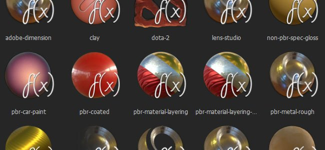

# カスタムシェーダ

Substance Painterはシェーダを使用して、リアルタイムビューポートでマテリアルをレンダリングします。

カスタムシェーダを記述して、新しい動作を実装したり、単にビューポートを他のレンダラーに一致させたりすることができます。 Substance Painter用のその他のシェーダーが[Substance share](https://share.allegorithmic.com/libraries?by_category_type_id=6)にあります。

## デフォルトシェーダ

デフォルトでは、Substance Painterには次のシェーダが含まれます。

{children}をレンダリングできません。 ページが見つかりません：既定のシェーダ。

## 新規シェーダの作成

新しい&#x200B;**.glsl**&#x200B;ファイルを作成するだけで、新しいカスタムシェーダを作成できます。

詳細な[シェーダー API](https://helpx.adobe.com/jp/substance-3d/unlisted/documentation/spdoc/custom-shader-api-89686018.html)を利用できます。新しい効果を作成し、既存のワークフローに統合するためのヘルパー機能を提供します。
