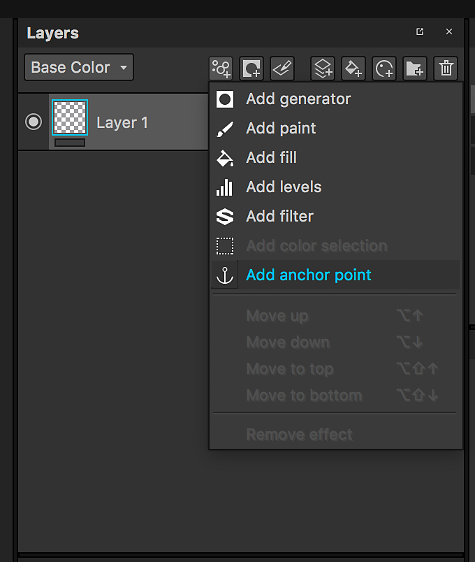
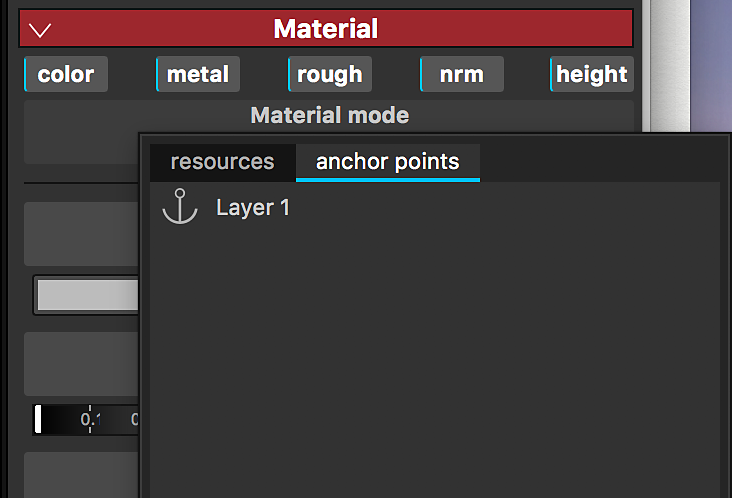
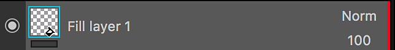
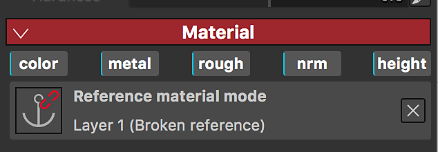
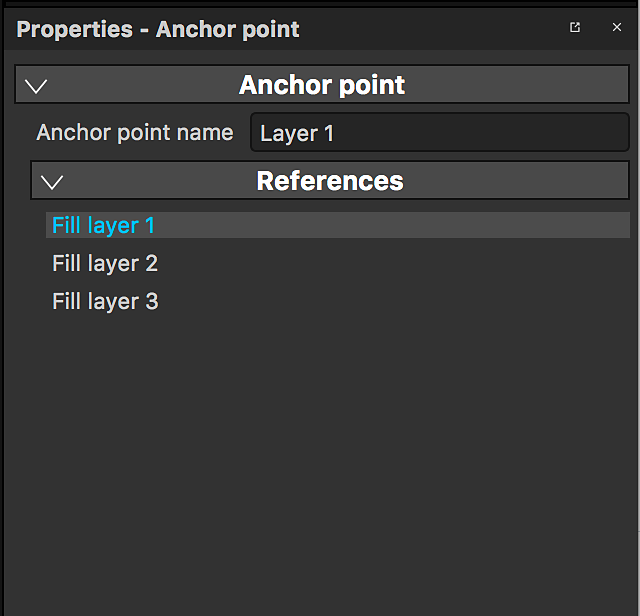
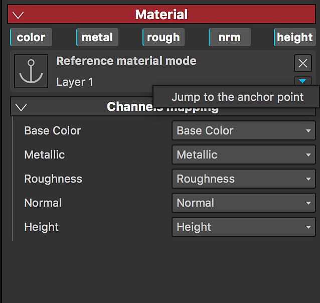

# アンカーポイント

アンカーポイントを使用すると、レイヤースタック内の任意のリソースまたはエレメントを表示できます。アンカーポイントは、レイヤースタックの様々な領域で参照し、目的や調整のセットに応じて使い分けることができます。 これにより、レイヤーやマスクを効果的にリンクし、1つのアンカーポイントをプロジェクトの複数の側面に影響させ、Substance 3D Painterを真に非線形な体験に変形することができます。

>[!NOTE]
>
> アンカーポイントは、同じテクスチャが作成された内部でのみ参照できます。 アンカーとその参照の間にリンクを設定して、テクスチャセット間のリンクを解除することはできません。

## アンカーポイントの追加

アンカーポイントは、エフェクトメニューで使用できます。 レイヤーとマスクの両方に追加できます。

## アンカーポイントを参照として使用する

アンカーポイントは別のレイヤーから参照できます。これにより、アンカーポイントの内容が、アンカーポイントを参照するレイヤーにインスタンス化されます。

アンカーポイントは、次のリソースで参照として使用できます。

* 塗りつぶしレイヤー
* 塗りつぶし効果
* サブスタンスフィルターの入力（エフェクト、プロシージャル、Generator）

参照するレイヤーの&#x200B;**下**&#x200B;にあるアンカーポイントのみを参照として使用できます。\
アンカーポイントを参照するレイヤーの上に移動すると、参照が解除されます。 この操作をキャンセルする場合は、取り消すことができます。

## アンカーポイントの参照の検索

アンカーポイントをクリックすると、そのアンカーポイントが参照として使用されているレイヤーのリストがプロパティに表示されます。

## アンカーポイントの検索

アンカーポイントを参照として使用する塗りつぶしレイヤーまたはエフェクトの場合は、アンカーポイントにジャンプできます。

