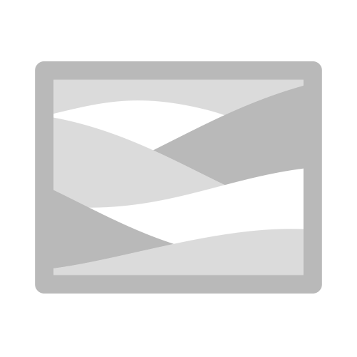

# 異方性桑原

<table>
<tr style="border: 0;">
<td width="33.33%" style="border: 0;" valign="top">

<b>In:</b>効果/グレースケール、桑原、異方性、スタイル化

</td>
<td width="100.00%" style="border: 0;" valign="top">

## 説明

異方性桑原フィルターは、強い方向性を保ったまま、絵画調のスタイルを適用します。

テクスチャレイヤー上またはマスク内（白黒出力）で、マテリアル、ノイズ、マスク全体をスタイライズした外観にするために使用します。

</td>
</tr>
</table>

## 入力

| 名前を入力 | 説明 |
| --- | --- |
| <b>半径マップ：</b>グレースケール | カスタムテクスチャまたはアンカーポイントを使用します。 |
| <b>カスタム入力：</b>カラー | カスタムテクスチャまたはアンカーポイントを使用します。 |

## パラメーター

| パラメーター名 | 説明 |
| --- | --- |
| <b>方向の抽出：</b> | フィルターのぼかし方向の導出方法を選択します。 |
| <b>半径：</b> | ぼかしの半径を調整します。 値が大きいほど、ブラーエフェクトが強くなります。 最大値は32です。 |
| <b>Smoothness:</b> | 計算された方向に沿ってカラーをブレンドする量を調整します。 0に設定すると、カラーはほとんどブレンドされずに同じ方向に変位します。 |
| <b>シャープ：</b> | ぼかした領域のコントラストを調整して、より平坦で鮮明な印象にします。 |
| <b>テンソルSmoothness:</b> | 画像から計算されて方向マップに保存された方向に適用されるぼかしの量を調整します。 値が大きいほど、画像に高周波数のディテールが多く含まれている場合の結果が滑らかになります。 |
| <b>異方性:</b> | 方向マップがぼかしに与える影響の強さを調整します。 マップは桑原フィルターカーネルで使用されるため、この値が0の場合でも、方向マップとその修飾子は結果に影響を与えます。 |
| <b>Anisotropy angle:</b> | 方向マップに適用される回転角度を順番に調整します。 この回転は、Anisotropy angleマップ入力の値に追加されます。 |

