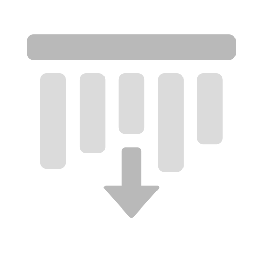
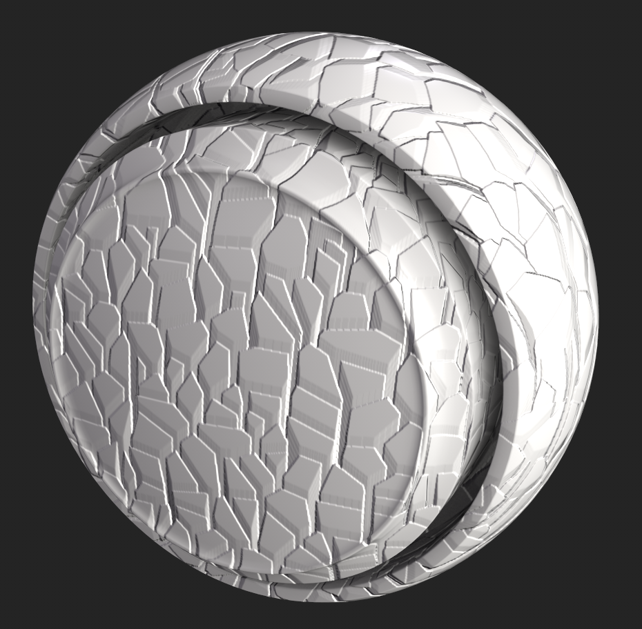

# 方向の距離

<table>
  <tr style="border: 0;">
    <td style="border: 0;" valign="top"> <strong>イン:</strong>効果/カラー、距離、方向、漏れ、雨</td>
    <td style="border: 0;" valign="top">説明 方向の距離フィルターは、選択した方向に進むグラデーションを作成します。 テクスチャレイヤーで使用され、方向の縞、漏れ、およびその他の距離に基づく効果を生み出します。 方向の距離フィルターをHeightチャンネルのマスクとして使用して、通常のチャンネルに立体感を加えることもできます。</td>
  </tr>
</table>

## 入力

| 名前を入力 | 説明 |
| --- | --- |
| **距離マップ:**&#x200B;グレースケール | カスタムテクスチャまたはアンカーポイントを使用します。 |

## パラメーター

| パラメーター名 | 説明 |
| --- | --- |
| **距離：** | 距離グラデーションの移動距離を正規化された画像領域で調整します。1は、入力画像の短い側の長さです。 |
| **角度：** | 距離グラデーションの方向を、0が右側を水平にする、または(1,0)ベクトルに沿って回転して調整します。 |
| **コントラスト：** | 結果のコントラストまたは減衰を調整します。 |
| **距離マップ乗数：** | 距離マップが最大距離に与える影響を調整します。 このパラメーターは、距離マップ入力が接続されていない場合には無効です。 |

## 例

次の例では、方向の距離フィルタを使用してセル2ジェネレータを3D表示します。

これは、Heightチャンネルを有効にし、値を1に設定して塗りつぶしレイヤーを作成することで実現できます。

次に、塗りつぶしレイヤーに黒のマスクを追加し、マスクにグレースケールを&#x200B;**セル 2**&#x200B;に設定した塗りつぶしを追加します。 これにより、次のマスクが作成されます。

>[!NOTE]
>
> **ビューポート**&#x200B;でマスクを表示するには、Altキーを押しながらマスクアイコンをクリックします。または、塗りつぶしレイヤーを選択した状態で、**ビューポート**&#x200B;のチャンネルドロップダウンを使用して、**マスク**&#x200B;を選択します。

次に、マスクにフィルターを追加し、方向の距離フィルターを選択します。

目的の結果を得るためにフィルター設定を調整しますが、マスクは次の例のようになります。

マテリアルビューに切り替えて、ビューポートで効果を確認します。
