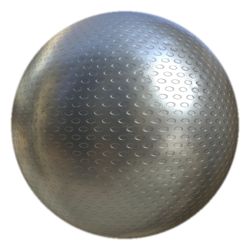

# 塗り潰し仕上げ穴あき円

<table>
<tr style="border: 0;">
<td width="33.33%" style="border: 0;" valign="top">

<b>イン：</b>効果/仕上げ、表面

</td>
<td width="100.00%" style="border: 0;" valign="top">

## 説明

[MatFinish穴あき円]フィルタは、メタル仕上げコレクションの一部であり、穴あき円を使用してメタル効果を作成するために使用します。

塗りつぶしレイヤーで使用されます。 基本塗りつぶしレイヤーの色、ラフネス、メタリック、およびその他のプロパティを調整し、最終的な表面処理に使用するフィルターを追加します。

</td>
</tr>
</table>

## パラメーター

| パラメーター名 | 説明 |
| --- | --- |
| <b>スケール：</b> | 仕上げの全体的なスケールを調整します。 |
| <b>穴のサイズ：</b> | 穴のサイズを調整します。 |
| <b>詳細の適用度：</b> | サーフェスのディテールの強度を調整します。 |

