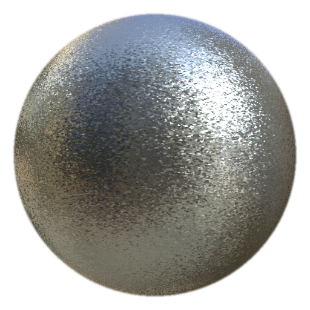

# 艶消し仕上げ粉体塗装

<table>
<tr style="border: 0;">
<td width="33.33%" style="border: 0;" valign="top">

<b>イン：</b>効果/仕上げ、表面

</td>
<td width="100.00%" style="border: 0;" valign="top">

## 説明

MatFinish Powder Coatedフィルターは金属仕上げコレクションの一部であり、粉体塗装金属効果を作成するために使用されます。

塗りつぶしレイヤーで使用されます。 基本塗りつぶしレイヤーの色、ラフネス、メタリック、およびその他のプロパティを調整し、最終的な表面処理に使用するフィルターを追加します。

</td>
</tr>
</table>

## 入力

| 名前を入力 | 説明 |
| --- | --- |
| <b>カスタムフレーク:</b>グレースケール | カスタムのフレークテクスチャまたはアンカーポイントを使用します。 |
| <b>位置：</b>カラー | ベイク位置マップを使用します。 |
| <b>ワールド空間法線:</b>色 | ワールド空間法線マップを使用します。 |

## パラメーター

| パラメーター名 | 説明 |
| --- | --- |
| <b>シード：</b> | ランダム値を割り当てると、全体的な設定を変更することなく、異なるバリエーションを作成できます。 |
| <b>スケール：</b> | 仕上げの全体的なスケールを調整します。 |
| <b>フレークの適用度：</b> | フレークの適用度を調整します。 |
| <b>カスタムフレークを使用する：</b> | カスタムフレークテクスチャの使用を切り替えます。 |
| <b>三平面マッピング：</b> | 三平面マッピングを切り替えます。 |

