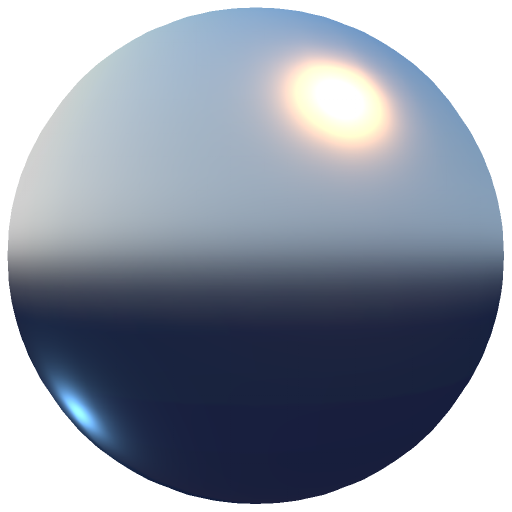

# ベイク照明スタイル化

<table>
<tr style="border: 0;">
<td width="33.33%" style="border: 0;" valign="top">

<b>イン:</b>効果/スタイル化、ライト、カラー

</td>
<td width="100.00%" style="border: 0;" valign="top">

## 説明

ベイク照明のスタイル設定フィルターは、マテリアルと照明の情報をカラーチャンネルにベイクします。

パススルーモードに設定されたペイントレイヤーで使用され、すべてのチャンネルに適用されます。 正確なシミュレートされた照明が不要な場合や、リソースが限られている場合（モバイルプロジェクトやカラーマップのみに依存するアセットなど）、定型化されたワークフローで役立ちます。

</td>
</tr>
</table>

## 入力

| 名前を入力 | 説明 |
| --- | --- |
| <b>Ambient occlusion:</b>グレースケール | Ambient occlusionマップを使用します。 |
| <b>曲率:</b>グレースケール | 曲率マップを使用します。 |
| <b>標準：</b>色 | 法線マップを使用します。 |
| <b>ワールド空間法線:</b>色 | ワールド空間法線マップを使用します。 |

## パラメーター

| パラメーター名 | 説明 |
| --- | --- |
| <b>入力：</b> | 入力マテリアルワークフローを選択します。 |
| <b>出力：</b> | 出力モードを選択します。 |
| <b>誘電体反射率：</b> | 誘電反射率を調整します。 |
| <b>Diffuse AO:</b> | 拡散反射光ライトのambient occlusion効果を調整します。 |
| <b>Diffuse空き領域：</b> | 空洞の割合を拡散反射光の照明に調整します。 |
| <b>Specular AO:</b> | Specular照明に対するambient occlusionの効果を調整します。 |
| <b>Specular空き領域：</b> | Specular照明に対する空洞の効果を調整します。 |
| <b>空洞のSmoothness:</b> | 空洞効果のSmoothnessを調整します。 |
| <b>エッジの適用度：</b> | エッジ効果の適用度を調整します。 |
| <b>エッジのSmoothness:</b> | エッジ効果のSmoothnessを調整します。 |
| <b>標準の詳細の種類：</b> | 使用する通常のディテールを選択します。 |
| <b>Heightから標準の強さ：</b> | Heightから法線への変換の強さを調整します。 |
| <b>太陽の強さ：</b> | 太陽光の強度を調整します。 |
| <b>太陽の水平角度：</b> | 太陽光の水平角度を調整します。 |
| <b>太陽の頂角：</b> | 太陽光の頂角を調整します。 |
| <b>太陽の色：</b> | 太陽光のカラーを調整します。 |
| <b>空の強さ：</b> | スカイライトの強さを調整します。 |
| <b>空の色：</b> | スカイライトのカラーを調整します。 |
| <b>地平線の色：</b> | 地平線の光のカラーを調整します。 |
| <b>地面の色：</b> | グラウンドライトのカラーを調整します。 |
| <b>水平角度：</b> | 追加するライトの強度を調整します。 |
| <b>頂角：</b> | 追加するライトの垂直角度を調整します。 |
| <b>強度：</b> | 追加するライトの強度を調整します。 |
| <b>色：</b> | 追加するライトのカラーを調整します。 |
| <b>水平角度：</b> | 2番目の追加光源の水平角度を調整します。 |
| <b>頂角：</b> | 2番目の追加光源の垂直角度を調整します。 |
| <b>強度：</b> | 2番目の追加ライトの強度を調整します。 |
| <b>色：</b> | 2番目の追加光源の色を調整します。 |

### マテリアル

| パラメーター名 | 説明 |
| --- | --- |
| **誘電体反射率：** | 誘電反射率の値を設定します。 |
| **Diffuse AO:** | ambient occlusionが拡散のディテールに与える影響を制御します。 |
| **Diffuse空き領域：** | 空洞領域が拡散のディテールに影響する度合いを制御します。 |
| **Specular AO:** | ambient occlusionがSpecularの詳細に与える影響を制御します。 |
| **Specular空き領域：** | 空洞領域がSpecularのディテールに与える影響を調整します。 |
| **空洞のSmoothness:** | 空洞領域の滑らかさを調整します。 |
| **エッジの適用度：** | エッジのディテールの強さを設定します。 |
| **エッジのSmoothness:** | 周縁部のSmoothnessを調整します。 |
| **標準の詳細の種類：** | 法線に使用するディテールを選択します。「メッシュのみ」または「メッシュ + Height +法線」のいずれかを選択します。 |
| **Heightから標準の強さ：** | 生成された法線のディテールの強さを調整します。 |

### 太陽と空

| パラメーター名 | 説明 |
| --- | --- |
| **太陽の強さ：** | 太陽の強さをコントロールします。 |
| **太陽の水平角度：** | 太陽の水平角度を調整します。 |
| **太陽の頂角：** | 太陽の垂直角度を調整します。 |
| **太陽の色：** | 太陽の色をコントロールします。 |
| **空の強さ：** | 空の強さを調整します。 |
| **空の色：** | 空のカラーを設定します。 |
| **地平線の色：** | 水平線のカラーを調整します。 |
| **地面の色：** | 地面のカラーを設定します。 |

### ライト 1

| パラメーター名 | 説明 |
| --- | --- |
| **水平角度：** | 追加するライトの水平角度を調整します。 |
| **頂角：** | 追加するライトの垂直角度を調整します。 |
| **強度：** | 追加光源の強さを調整します。 |
| **色：** | 追加するライトのカラーを設定します。 |

### ライト 2

| パラメーター名 | 説明 |
| --- | --- |
| **水平角度：** | 2番目の追加光源の水平角度を調整します。 |
| **頂角：** | 2番目の追加光源の垂直角度を調整します。 |
| **強度：** | 2番目の追加光源の強さを調整します。 |
| **色：** | 2番目の追加光源の色を設定します。 |
