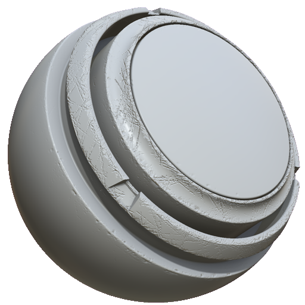

# MatFXエッジの損害

<table>
<tr style="border: 0;">
<td width="33.33%" style="border: 0;" valign="top">

<b>イン:</b>効果/ぼかし、グレースケール

</td>
<td width="100.00%" style="border: 0;" valign="top">

## 説明

MatFX Edge Damageフィルタは、エッジの欠損や破損の詳細を作成します。 エッジダメージは、エッジダメージがダメージ領域のカラーを変えないという点で、MatFXディテールEdge Wearフィルターとは異なる動作をします。 つまり、金属の塗装のようなマテリアルに適したEdge Wearではなく、プラスチックや樹脂などのマテリアルのダメージをシミュレーションするのに役立ちます。

MatFX Edge Damageは、テクスチャレイヤーやマテリアルスタックに使用され、磨耗、傷、損傷したエッジのディテールを加えます。

</td>
</tr>
</table>

>[!NOTE]
>
> MatFX Edge DamageフィルタでHeightチャンネルを変更するには、チャンネルに既存のHeightデータが必要です。 つまり、フィルターレイヤーの下にHeightデータを持つレイヤーがない場合、フィルターはHeightチャンネルに対して目に見える効果はありません。

## パラメーター

| パラメーター名 | 説明 |
| --- | --- |
| <b>ぼかしの強さ：</b> | ブラーエフェクトの強さを調整します。 |
| <b>ぼかしの回り込み：</b> | ぼかしのラップを切り替えます。 有効にすると、テクスチャの反対側からピクセルがサンプリングされます。 |
| <b>レベル：</b> | 全体的な損傷レベルを調整します。 |
| <b>コントラスト：</b> | 結果のコントラストまたは減衰を調整します。 |
| <b>Scratchesの適用度：</b> | スクラッチの強度を調整します。 |
| <b>損害ラフネス:</b> | 破損している領域のラフネスを調整します。 |
| <b>損害深度:</b> | 破損している領域の深度を調整します。 |
