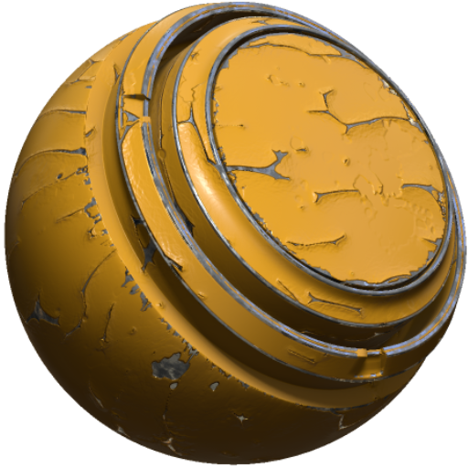

# MatFX剥離ペイント

<table>
<tr style="border: 0;">
<td width="33.33%" style="border: 0;" valign="top">

<b>イン:</b>効果/ぼかし、グレースケール

</td>
<td width="100.00%" style="border: 0;" valign="top">

## 説明

MatFX剥離ペイントフィルターは、剥離や剥離のペイント効果を生み出します。

テクスチャ層やマテリアルスタックに使用され、剥離ペイントや欠けたコーティングをシミュレートし、下地のマテリアルを表示します。

</td>
</tr>
</table>

>[!NOTE]
>
> 下にあるマテリアルを表示するには、グループ内でMatFX Pearing ペイントを使用します。 レイヤースタック内のグループの外側とその下のレイヤーは、剥がれたペイントが表面から離れる場所に表示されます。

## パラメーター

| パラメーター名 | 説明 |
| --- | --- |
| <b>ぼかしの強さ：</b> | ブラーエフェクトの強さを調整します。 |
| <b>ぼかしの回り込み：</b> | ぼかしのラップを切り替えます。 有効にすると、テクスチャの反対側からピクセルがサンプリングされます。 |
| <b>ピーリングレベル:</b> | 全体のピーリングレベルを調整します。 |
| <b>ピーリングの距離：</b> | ペイントが剥がれているように見える範囲を調整します。 |
| <b>フレークレベル：</b> | フレークの量を調整します。 |
| <b>気泡の密度：</b> | 気泡の密度を調整します。 |
| <b>フレーク密度：</b> | フレークの密度を調整します。 |
| <b>フレークXの量：</b> | X軸に沿ってフレークの量を調整します。 |
| <b>フレークY量：</b> | Y軸に沿ってフレークの量を調整します。 |
| <b>曲率を使用：</b> | 曲率入力の使用を切り替えます。 |
| <b>曲率の距離：</b> | 曲率のサンプリング距離を調整します。 |
| <b>曲率のコントラスト：</b> | 曲率入力のコントラストを調整します。 |

### 技術パラメーター

これらのパラメーターを使用すると、剥がれたマテリアルの上面を編集できます。

| パラメーター名 | 説明 |
| --- | --- |
| <b>輝度：</b> | 輝度を調整します。 |
| <b>コントラスト：</b> | 結果のコントラストまたは減衰を調整します。 |
| <b>色相シフト:</b> | 色相シフトを調整します。 |
| <b>彩度：</b> | 彩度を調整します。 |
| <b>法線の強度：</b> | 法線の強度を調整します。 |
| <b>Height範囲：</b> | エフェクトで使用するHeight範囲を調整します。 |
| <b>Heightの位置：</b> | エフェクトで使用するHeightの位置を調整します。 |
| <b>Ambient occlusionの強さ：</b> | ambient occlusionの適用度を調整します。 |
