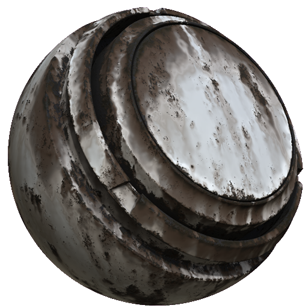

# MatFX風化

<table>
<tr style="border: 0;">
<td width="33.33%" style="border: 0;" valign="top">

<b>イン:</b>効果/ぼかし、グレースケール

</td>
<td width="100.00%" style="border: 0;" valign="top">

## 説明

MatFX 風化フィルタは、マテリアル全体に錆の蓄積と風化を生み出します。

テクスチャ層やマテリアルスタックに使用され、腐食、滴り、経年風化効果を加えます。

</td>
</tr>
</table>

## パラメーター

| パラメーター名 | 説明 |
| --- | --- |
| <b>ぼかしの強さ：</b> | ブラーエフェクトの強さを調整します。 |
| <b>ぼかしの回り込み：</b> | ぼかしラップのオン/オフを切り替えます。 ぼかしラップがオンの場合は、テクスチャの反対側からピクセルがサンプリングされます。 |
| <b>錆の分散：</b> | 錆間隔を調整します。 |
| <b>Smoothnessの展開：</b> | 展開Smoothnessを調整します。 |
| <b>ニスのダメージスケール：</b> | ニスの損傷スケールを調整します。 |
| <b>滴の強さ：</b> | 滴りの強さを調整します。 |
| <b>滴のサンプル量：</b> | ドリップサンプル量を調整します。 |
| <b>Smoothnessの滴り：</b> | しずくのSmoothnessを調整します。 |

### 合成

| パラメーター名 | 説明 |
| --- | --- |
| <b>法線の強度：</b> | 法線マップのブレンド強度を調整します。 |
| <b>Ambient occlusionの強さ：</b> | AOマップのブレンド強度を調整します。 |
| <b>Heightの強さ：</b> | 高さマップのブレンド強度を調整します。 |

**メタリックラフネス**

| パラメーター名 | 説明 |
| --- | --- |
| <b>Base colorの強さ：</b> | base colorの適用度を調整します。 |
| <b>ラフネスの強さ：</b> | ラフネスマップのブレンド強度を調整します。 |
| <b>メタリック強度：</b> | メタリックマップのブレンド強度を調整します。 |
