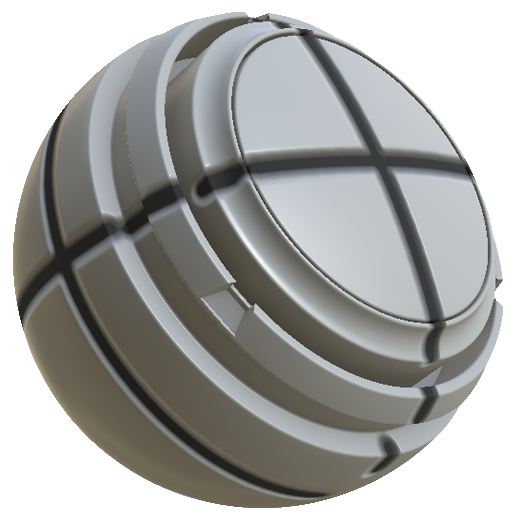

# MatFXシャットダウンライン

<table>
<tr style="border: 0;">
<td width="33.33%" style="border: 0;" valign="top">

<b>イン:</b>効果/ぼかし、グレースケール

</td>
<td width="100.00%" style="border: 0;" valign="top">

## 説明

MatFXシャットラインフィルタは、マテリアル上にパネルラインまたはシームの詳細を作成します。

テクスチャレイヤーまたはマテリアルスタックに使用して、閉じた線、エンボスシーム、および裏付けとなるHeightとカラーの詳細を追加します。

</td>
</tr>
</table>

## パラメーター

| パラメーター名 | 説明 |
| --- | --- |
| <b>空洞の幅：</b> | キャビティの幅を調整します。 |
| <b>勾配の強さ：</b> | 勾配効果の適用度を調整します。 |
| <b>強さ:</b> | エンボスの強さを調整します。 |
| <b>Heightの強さ：</b> | Height効果の適用度を調整します。 |

### マテリアル

| パラメーター名 | 説明 |
| --- | --- |
| <b>線の色：</b> | 線のカラーを調整します。 |
| <b>ソースマテリアルの不透明度：</b> | ソースマテリアルの不透明度を調整します。 |
