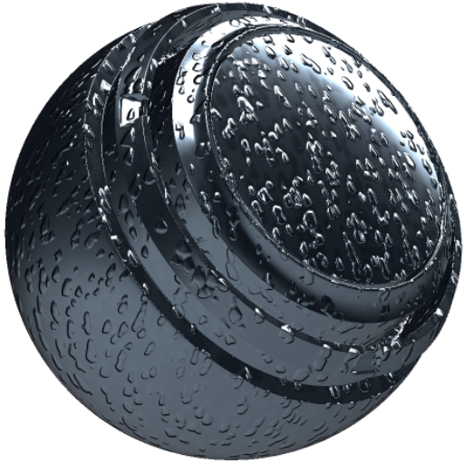

# MatFX水滴

<table>
<tr style="border: 0;">
<td width="33.33%" style="border: 0;" valign="top">

<b>イン:</b>効果/ぼかし、グレースケール

</td>
<td width="100.00%" style="border: 0;" valign="top">

## 説明

MatFX水滴フィルタは、マテリアルに水滴とランオフ効果を作成します。

テクスチャ層やマテリアルスタックに使用され、ドロップレット、指向性筋、湿面のバリエーションを加えます。

</td>
</tr>
</table>

## 入力

| 名前を入力 | 説明 |
| --- | --- |
| <b>Ambient occlusion:</b>グレースケール | ambient occlusionマップを使用します。 |
| <b>ワールド空間法線:</b>色 | ワールド空間法線マップを使用します。 |
| <b>位置：</b>カラー | ベイク位置マップを使用します。 |

## パラメーター

| パラメーター名 | 説明 |
| --- | --- |
| <b>降下量：</b> | 水滴の量を調整します。 |
| <b>ドロップスケールX:</b> | ドロップのXスケールを調整します。 |
| <b>ドロップスケールY:</b> | ドロップのYスケールを調整します。 |
| <b>スケールランダムをドロップ：</b> | ドロップのランダムスケールの変動量を調整します。 |
| <b>方向の強度を下げる：</b> | ドロップの方向の強度を調整します。 |

### 位置

| パラメーター名 | 説明 |
| --- | --- |
| <b>影響度X:</b> | 位置入力のXインフルエンスを調整します。 |
| <b>影響度Y:</b> | 位置入力のYの影響を調整します。 |
| <b>影響度Z:</b> | 位置入力のZの影響を調整します。 |

### 水の蓄積

| パラメーター名 | 説明 |
| --- | --- |
| <b>強度：</b> | 水の堆積の強度を調整します。 |
| <b>スプレッド：</b> | 水の貯留の広がりを調整します。 |
| <b>AOベースの強度：</b> | ambient occlusionが水の貯留に与える影響を調整します。 |

### ワールド空間

| パラメーター名 | 説明 |
| --- | --- |
| <b>マスク強度：</b> | ワールド空間マスクの強度を調整します。 |
| <b>最強：</b> | 上向きの領域での水滴の強さを調整します。 |
| <b>下の照度：</b> | 下向きに表示されている領域のドロップアウトの強さを調整します。 |
| <b>フロント照度：</b> | 前面に表示される領域のドロップアウトの強さを調整します。 |
| <b>戻る強さ：</b> | 背面にある領域のドロップアウトの強さを調整します。 |
| <b>右の照度：</b> | 右向きの領域での水滴の強さを調整します。 |
| <b>左の照度：</b> | 左向きの領域での水滴の強さを調整します。 |

### マテリアル

| パラメーター名 | 説明 |
| --- | --- |
| <b>Base colorワープの強さを下げる：</b> | ドロップアウトするbase colorに適用されるワープの強さを調整します。 |
| <b>回転ベクトルマップマルチプライヤを削除：</b> | ドロップ回転ベクトルマップに適用される乗数を調整します。 |
| <b>Heightの照度を下げる：</b> | ドロップHeightエフェクトの強さを調整します。 |
| <b>ラフネスの削除：</b> | ドロップのラフネスを調整します。 |
| <b>ラフネスのブレンドを削除します：</b> | ドロップラフネスとマテリアルのブレンド方法を調整します。 |
| <b>メタリックのドロップ：</b> | ドロップのメタリック値を調整します。 |
| <b>メタリックブレンドを削除：</b> | ドロップメタリック値とマテリアルのブレンド方法を調整します。 |
| <b>法線の強度：</b> | 法線の効果の強さを調整します。 |
