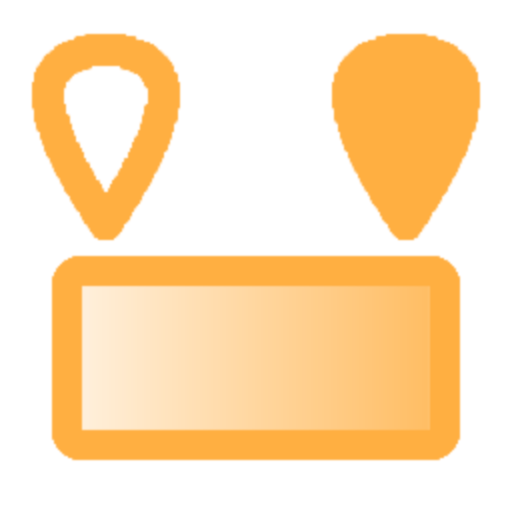

# グラデーション

<table>
<tr style="border: 0;">
<td width="33.33%" style="border: 0;" valign="top">

<b>イン:</b>エフェクト/グレースケール

</td>
<td width="100.00%" style="border: 0;" valign="top">

## 説明

グラデーションフィルターは、カスタムグラデーションを使用して、画像内のグレースケール値を再マップします。

このエフェクトは、グレースケールイメージの値を微調整したり、カスタムグラデーションにマッピングしてグレースケール入力を色付けしたりするために使用できます。

</td>
</tr>
</table>

## パラメーター

| パラメーター名 | 説明 |
| --- | --- |
| <b>グラデーションの表示（デバッグ）:</b> | グラデーションデバッグビューの表示を切り替えます。 |
| <b>色数：</b> | グラデーションで使用するカラーの数を調整します。 |
| <b>線形のブレンド色：</b> | リニアカラーブレンドを切り替えます。 |
| <b>色1:</b> | 最初のカラーを選択します。 |
| <b>色1の位置：</b> | 最初のカラーの位置を調整します。 |
| <b>色2:</b> | 2番目のカラーを選択します。 |
| <b>色2の位置：</b> | 2番目のカラーの位置を調整します。 |
| <b>色N:</b> | N番目のカラーを選択します。 |
| <b>色Nの位置：</b> | N番目のカラーの位置を調整します。 |

### 入力変換

<table>
<tr>
<td><b>グレースケールモード：</b></td>
<td>グレースケール変換モードを選択します。 彩度低下、輝度、平均、最大、最小から選択できます。</td>
</tr>
<tr>
<td><b>ぼかしの強度：</b></td>
<td>入力のぼかしの量を調整します。</td>
</tr>
<tr>
<td><b>バランス:</b></td>
<td>明るさコントロールと同様に、中心点を黒または白にシフトして入力のバランスを調整します。</td>
</tr>
<tr>
<td><b>コントラスト：</b></td>
<td>入力のコントラストを調整します。</td>
</tr>
<tr>
<td><b>反転：</b></td>
<td>入力カラーの反転を切り替えます。</td>
</tr>
</table>
