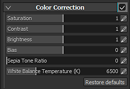

# カラー補正

カラー補正パラメーター：

| *設定* | *説明* |
| --- | --- |
| **彩度** | ビューポートのカラーの適用度/彩度を制御します。 0に設定した彩度を使用して、グレースケールレンダリングを行います。 |
| **コントラスト** | 明るいカラーと暗いカラーの差を調整します。 |
| **明るさ** | カラーの明るさ/輝度を制御します。 |
| **バイアス** | ビューポートの輝度をグローバルにオフセットします。 |
| **セピア調の比率** | ビューポートにセピア効果を与える詳細パラメーター。 |
| **ホワイトバランスの色温度(K)** | 色の温度（ケルビン単位）。 既定値は6500Kで、法面展開に対応します。 [詳細については、ウィキペディアを参照してください](https://en.wikipedia.org/wiki/Color_temperature)。 |
