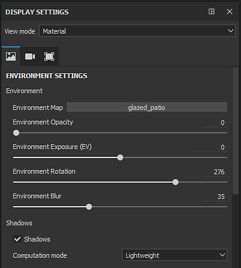
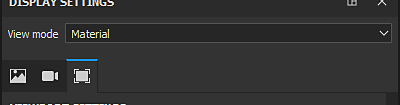

# 表示設定

{width="320px"}

**ディスプレイの設定**&#x200B;ウィンドウは、環境、カメラ、およびビューポートの設定を再グループ化します。 これらの設定はプロジェクト全体に適用され、ビューポートの外観に影響を与える可能性があります。

## 表示モード

ビューモードは、ビューポートの外観を制御します。 ドロップダウンは、次の3つのセクションに分かれています。

| セクション | 説明 |
| --- | --- |
| **照明** | 3Dモデルをビューポートに表示し、シャドウ（有効な場合）も含めて完全な照明を当てます。 |
| **シングルチャンネル** | 「solo mode（ソロモード）」とも呼ばれる。 照明を使用せずに、指定したチャンネルまたはテクスチャのみでビューポートのメッシュを表示します。 |
| **メッシュマップ** | 照明を使用せずに、ベイクしたテクスチャのみを使用して、ビューポートにメッシュを表示します。 |

>[!NOTE]
>
> [ビューポート](../../interface/viewport/viewport.md)の隅にある<b>ドロップダウン</b>を使用して、表示モードを変更することもできます。 チャンネルやメッシュマップをすばやく切り替えたり、マテリアルモードに戻ったりするために使用できる[ショートカット](../settings/shortcuts.md)もあります。

## 表示設定セクション

各セクションの詳細については、専用ページを参照してください。

* [環境設定](environment-settings.md)
* [カメラ設定](camera-settings.md)
* [ビューポート設定](viewport-settings.md)
