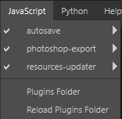

# JavaScriptおよびPythonプラグインメニュー

JavaScriptメニューとPythonメニューには、Painterの起動時に読み込まれるすべてのプラグインのリストが表示されます。 プラグインは、使用しているスクリプトAPI（JavascriptまたはPython）に基づいて2つのメニューに分割されます。

アプリケーションによって検出された各プラグインは、追加の機能にアクセスするためのエントリをそれぞれのメニューに追加します。 メニューの各プラグインには、次のオプションがあります。

* **無効/有効**:プラグインのオンとオフを切り替えます。
* **再読み込み**:アプリケーションの実行中にスクリプトが更新された場合に備えて、プラグインを再読み込みします。
* **構成**:プラグインでサポートされている場合は、プラグインを構成するための関数/ウィンドウを表示します。
* **バージョン情報**:プラグインでサポートされている場合は、プラグインに関する情報を表示します。

Painterで提供されるデフォルトのプラグインの詳細、または新しいプラグインを自分で作成する方法については、専用の[プラグイン](../../features/plugins/plugins.md)ページを参照してください。
