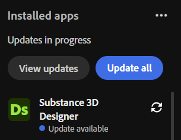

# 更新チェッカー

Creative CloudデスクトップからSubstance 3D Painterのアップデートを確認できます。 「アプリ」タブに移動し、「インストール済みアプリ」セクションを確認します。 更新プログラムのダウンロードの準備ができると、**利用可能な更新プログラム**&#x200B;がアプリ名の下に表示されます。

Painterを開き、**ヘルプ/リリースノート**&#x200B;を使用して、現在のリリースのリリースノートにアクセスできます。
