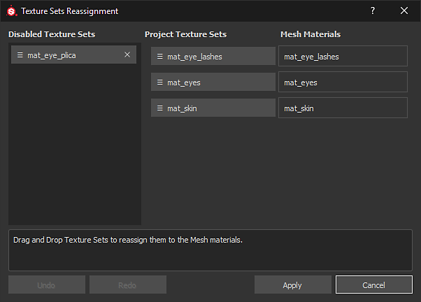
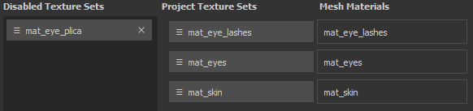

# テクスチャセット再割り当て

「テクスチャセットの再割り当て」ウィンドウでは、シーンメッシュの別の部分にレイヤースタックを割り当てることができます。 これは、新しいメッシュを既存のプロジェクトに読み込んだ後、一部のテクスチャセットが無効になった場合などに便利です。 これは、レイヤースタックが既に存在しないマテリアルに割り当てられたために発生します。 再割り当てウィンドウを使用すると、そのレイヤースタックを元に戻すことができます（後述の「無効なテクスチャセットの復元」を参照してください）。

テクスチャセットの再割り当てウィンドウにアクセスするには、[テクスチャセットリスト](texture-set-list.md)ウィンドウで&#x200B;**設定/テクスチャセットの再割り当て**&#x200B;を選択します。

ウィンドウは3つのセクションに分かれています。

* **無効なテクスチャセット** ：現在使用されていないすべてのテクスチャセットを一覧表示します。
* **プロジェクトテクスチャセット** :メッシュマテリアルに現在割り当てられているすべてのテクスチャセットを一覧表示します。
* **マテリアル** :プロジェクトのメッシュマテリアルを一覧表示します。

このウィンドウには、次のアクションを実行する追加のボタンもあります。

* **取り消し** ：ウィンドウを以前の状態に戻します
* **やり直し** ：取り消された変更を再適用します。
* **適用** ：ウィンドウを閉じて、再割り当てを実行します。
* **キャンセル** ：ウィンドウを閉じ、進行中の変更をすべて破棄します。

## テクスチャセットの再割り当て

テクスチャセットの再割り当ては、ボタンをドラッグ&amp;ドロップするだけで実行できます。

## 無効にしたテクスチャセットの復元

テクスチャセットは、メッシュマテリアルに関連付けられていないときに無効にすることができます。\
このエラーは、プロジェクトと新しいメッシュでマテリアル名が異なる場合に、新しいメッシュをプロジェクトに読み込むときに発生することがあります。

テクスチャセットを復元するには、「**プロジェクトテクスチャセット**」の一覧にあるアセットと&#x200B;**入れ替え**&#x200B;でその場所を入れ替えます。

## 無効なテクスチャセットの削除

**無効になっているテクスチャセット**&#x200B;の一覧でテクスチャセットの横にある&#x200B;**クロス**&#x200B;をクリックすると、**削除対象としてマーク**&#x200B;されます。\
削除は、ウィンドウの下部にある「**適用**」ボタンをクリックしたときに実行されます。

>[!WARNING]
>
> 「適用」ボタンでウィンドウを閉じると、このアクションは取り消せません。
