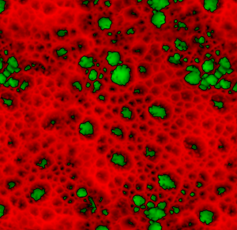

# 高さマップペイント

## 一般的な概念

通常の作業台で作業するのではなく、高い作業台で作業する方が、品質、管理性、柔軟性、アセット間の一貫性の向上など、多くのメリットがあります。

このプロセスは次のようになります。

* ローポリメッシュからベイクされた法線マップがハイポリメッシュにロードされます。
* heightmapチャンネルで詳細をペイントします。
* ペイントしたHeightはすべてのレイヤーで合成され、リアルタイムで法線マップに変換され、最終的にハイポリメッシュの法線とブレンドされます。

あなたが心配しなければならないすべては、そのHeightを塗ることであり、残りはすべて自動で行われます。

### HDR形式

Heightチャンネルは、**HDR**&#x200B;のカラーフォーマットを使用しています。従来の0 ～ 255のペイントを使用する高さマップとは異なり、明るさの制限に達することなく、正の値と負の値の彩度を指定できます。

* Height上のビットマップまたはサブスタンスでペイントすると、そのソースは元の[0,255]範囲から[-1,1]範囲に再マップされます。

グレーの中間は0に再マップされます。 したがって、127より小さい値はheightmapから&#x200B;**減算**&#x200B;され、127より大きい値は高さマップのデフォルトの描画モードである&#x200B;**覆い焼きリニア（加算）**&#x200B;を使用する場合にheightmapに&#x200B;**加算**&#x200B;されます。

* 単色でペイントする場合は、-1 ～ 1の値を直接選択できます。

### Height可視化

単独モードで高さマップを表示している場合、デフォルトのプレビューには正の値のみが表示され、負の値の場合は強い黒の彩度が表示されます。

**+/ – カラー**&#x200B;設定では、正の値と負の値に異なる色を使用して範囲全体を表示できます。

**拡大・縮小**&#x200B;設定を使用すると、デフォルトの[-1,1]範囲を超えて追加または削除した場合に、HDRマップの表示範囲を変更できます。

<table>
<tr style="border: 0;">
<td style="border: 0;" valign="top">

</td>
<td style="border: 0;" valign="top">

</td>
</tr>
</table>
