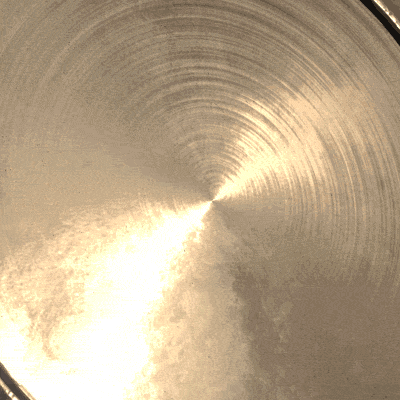

# 動的ストローク

<table>
<tr style="border: 0;">
<td style="border: 0;" valign="top">

{width="400px"}

</td>
<td style="border: 0;" valign="top">

{width="350px"}

</td>
</tr>
</table>

**動的ストローク**&#x200B;は、**Substanceファイル**&#x200B;を利用した通常のブラシストロークで、**ブラシストローク**&#x200B;内のスタンプごとに&#x200B;**変更**&#x200B;できます。

ブラシストロークと一緒に配置された個々のオブジェクトは、Substanceファイル自体で指定されたビヘイビアーに基づいて変更できます。

詳しくは、次のページを参照してください。

* [ダイナミックストローク機能の有効化](enabling-dynamic-stroke-feature.md)
* [動的なストロークのパフォーマンス](dynamic-stroke-performances.md)
* [カスタム動的ストロークの作成](creating-custom-dynamic-strokes.md)
