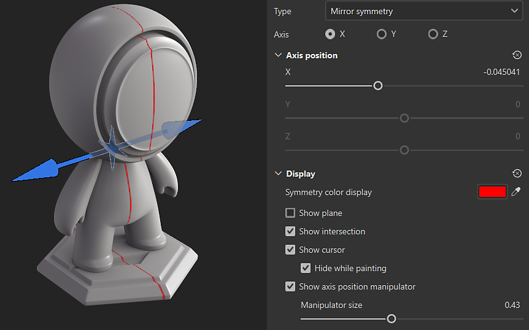

# ミラー対称

ミラー対称は軸に基づいた対称で、コンテキストツールバーで有効にできます。

## マニピュレーターを使用して対称の軸を配置する

対称の表示設定には、3Dビューの上部にあるコンテキストツールバーの<b>対称設定ボタン</b>からアクセスできます。 表示設定で、マニピュレーターを有効にしてカスタマイズできます。 3Dビューでマニピュレーターハンドルをドラッグして、対称軸の位置を変更します。

## ミラー対称パラメーター

{width="300px"}

| *パラメーター* | *説明* |
| --- | --- |
| <b>軸</b> | 対称の実行に使用するシーンの軸を指定します。 |
| <b>軸の位置</b> | プロジェクト内の軸のオフセットを指定します。 この値は、スライダーまたはマニピュレーターを使用して編集できます（上記を参照）。 |
| <b>平面の表示</b> | 有効にすると、ミラー対称の各側面を区切る透明な平面がビューポートに表示されます。 |
| <b>交差点を表示</b> | 有効にすると、ミラー対称の両側を区切る線がビューポートのメッシュに描画されます。 |
| <b>カーソルの表示</b> | 有効にすると、対称の反対側に2番目のカーソルが表示され、ペイントが実行されるタイミングが示されます。 |
| <b>描画中に非表示にする</b> | このオプションを有効にすると、ペイントの実行中（マウスクリックを放すまで）に2番目のカーソルが非表示になります。 |
| <b>マニピュレーターサイズ</b> | ビューポートのマニピュレーターのサイズを制御します。 |
