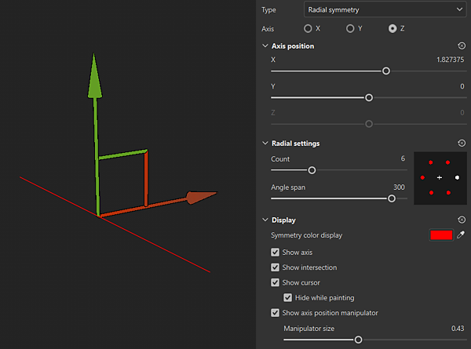

# ラジアル対称

放射状対称では、軸の放射状にストロークまたは塗りつぶしレイヤーコンテンツが複製されます。

## マニピュレーターを使用して対称の軸を配置する

対称の表示設定には、3Dビューの上部にあるコンテキストツールバーの<b>対称設定ボタン</b>からアクセスできます。 表示設定で、マニピュレーターを有効にしてカスタマイズできます。 3Dビューでマニピュレーターハンドルをドラッグして、対称軸の位置を変更します。

{width="600px"}

## 円形対称パラメーター

![プロパティパネルの[対称]セクションのスクリーンショット](../../assets/FillSymmetry_1.png){width="300px"}

| *パラメーター* | *説明* |
| --- | --- |
| <b>軸</b> | 対称の実行に使用するシーンの軸を指定します。 |
| <b>コピーを反転</b> | U方向またはV軸に交互にコピーを反転します。 これは、テキストなどの方向を持つコンテンツで対称を使用する場合に役立ちます。 |
| <b>軸の位置： X、Y、Z</b> | プロジェクト内の軸のオフセットを指定します。 この値は、スライダーまたはマニピュレーターを使用して編集できます（上記を参照）。 |
| <b>軸を表示</b> | 有効にすると、対称の軸を表すビューポートに透明線が表示されます。 |
| <b>交差点を表示</b> | 有効にすると、対称の軸がメッシュと交差する場所を示すために、ビューポートのメッシュにポイントが描画されます。 |
| <b>カーソルを表示（ブラシツール）</b> | 有効にすると、対称の反対側に2番目のカーソルが表示され、ペイントが実行されるタイミングが示されます。 |
| <b>ペイント中は非表示（ブラシツール）</b> | このオプションを有効にすると、ペイントの実行中（マウスクリックを放すまで）に2番目のカーソルが非表示になります。 |
| <b>軸の職位マニピュレーターを表示する</b> | ビューポートのマニピュレーターの表示を切り替えます。 |
| <b>マニピュレーターサイズ</b> | ビューポートのマニピュレーターのサイズを制御します。 |
