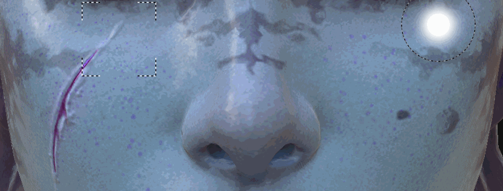

# クローンツール

Substance 3D Painter 2で導入されたクローンツールは、[ペイントツール](https://support.allegorithmic.com/documentation/display/SPDOC/Paint+brush)と同じ種類のパラメーターを共有します。 その名前が示すように、コピーツールを使用すると、特定のレイヤーの内容またはレイヤースタック全体を、あるポイントから別のポイントに複製できます。

## 使用状況

クローンツールは、ペイントレイヤーの内容に対して使用するのが最も簡単です。

これは2つの手順で実行できます。

* モデルにマウスを置いて「 **V** 」キーを押し、ソースの場所を選択します。
* 次に、複製した領域が表示される場所にマウスを配置して、ペイントを開始します。

「**V** 」をもう一度押すと、いつでもソースを更新できます。

デフォルトでは、クローンツールでペイントする場合、ブラシを放すとソースの場所に従って場所が更新されます。 「**クローンソースビヘイビアー**」に使用されるボタンを無効にすると、「**V**」を押したときにソースが定義された場所に戻ります。 これは、同じソース領域を使用して複数回ペイントする場合に便利です。

クローンツールをより効率的に使用するには、ペイントレイヤーを作成し、すべてのチャンネルの描画モードを「通過」に設定します。 これにより、「クローンレイヤー」の下にあるすべてのレイヤーから元のデータを損なわずに複製できます。 以下のレイヤーはそのままで、後で適用された変更はクローンレイヤーによって考慮されます。

