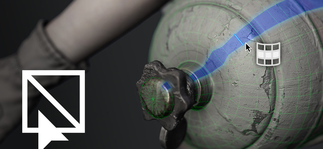
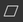

# ポリゴン塗りつぶし

**多角形の塗りつぶし**&#x200B;ツールは、マテリアルチャンネル値またはグレースケールマスク値で多角形を塗りつぶします。 ペイントレイヤー、エフェクト、マスクに使用して、メッシュの一部をすばやく塗りつぶすことができます。

このツールは、選択ツールではなくペイントツールです。このため、使用後は消しゴムツールを使用するか、その上に入力することによってのみ消去できます。

このツールには、ツールツールバーからアクセスできます。

## 設定

**多角形の塗りつぶし**&#x200B;ツールで、**プロパティ**&#x200B;ウィンドウから利用できる設定の一覧を次に示します。

### 選択モード

選択モードでは、メッシュジオメトリの三角形と四角形の選択方法を制御します。

| **モード** | **説明** |
|---|---|
|  **長方形選択ツールによる塗りつぶし** | 長方形の選択範囲を作成するには、クリックしてドラッグします。 **塗りつぶしモード**&#x200B;では、どのジオメトリを塗りつぶすかを定義し、**ヒットテスト**&#x200B;ではどのポリゴンを含めるかを定義します。   |
|  **多角形ループ塗りつぶし** | ワンクリックで四角のループを塗りつぶします。 ドラッグすると複数のループが選択されます。   |
|  **部分的な多角形ループの塗りつぶし** | クリック&amp;ドラッグでループの一部を塗りつぶします。 選択を二次ループに沿って拡張して、ポリゴンのパッチを形成できます。   |

### 塗りつぶしモード

塗りつぶしモードは、**長方形選択による塗りつぶし**&#x200B;モードでのみ使用でき、ジオメトリのどの部分を選択するかを制御します。

| **モード** | **説明** |
|---|---|
|  **三角形の塗りつぶし** | 個々のメッシュ三角形を塗りつぶします。 |
|  **多角形の塗りつぶし** | ポリゴン全体を塗りつぶします。 読み込む前に三角パッチ化したメッシュの結果は、**三角形の塗りつぶし**&#x200B;と同じです。 |
|  **メッシュの入力** | クリックしたポリゴンにコネクトされているすべてのポリゴンを塗りつぶします。 |
|  **UVチャンクフィル** | UV空間に接続されたポリゴンを塗りつぶします。 塗りつぶしはUVの境界で停止します。 |

### ヒットテスト

ヒットテスト設定は、**長方形選択ツールによる塗り**&#x200B;モードで三角形と四角形を選択する方法を制御します。

| **モード** | **説明** |
|---|---|
|  **交差点** | （デフォルト）ポリゴンのジオメトリの一部が選択領域の内側にあるか、選択領域と交差している場合、そのポリゴンは塗りつぶされます。 |
|  **含まれている中心** | 多角形は、その中心点が選択範囲の内側にある場合にのみ塗りつぶされます。 |
| **表示されているポリゴンのみ** | 有効な場合、塗りつぶしは現在のカメラビューから表示されているポリゴンにのみ影響します。 隠線および背面のポリゴンは無視されます。 無効にすると、メッシュを使用してポリゴンを塗りつぶすことができます。 |

### 合成

これらの設定は、塗りつぶしの結果と下のピクセルとの混合を制御します。

| **パラメーター** | **説明** |
|---|---|
| 描画モード | 塗りつぶしを既存のピクセル値とどのようにブレンドするかを制御します。 **マテリアル**&#x200B;モードでは、描画モードは&#x200B;**マテリアル**&#x200B;セクションで有効になっているすべてのチャンネルに適用されます。 |
| 不透明度 | 塗りの不透明度を制御します。 |

>[!NOTE]
>
> このツールでは、レイヤースタックと同じ描画モードがサポートされています。 詳しくは、[描画モードのドキュメントページ](https://experienceleague.adobe.com/en/docs/substance-3d-painter/using/interface/layer-stack/blending-modes)を参照してください。

### マテリアル

マテリアルセクションでは、ツールでペイントできるチャンネルを制御します。

## ショートカット

多角形の塗りつぶしツールは、次のショートカットキーを使用すると効果的に使用できます。

| **ショートカット** | **説明** |
|---|---|
| **Alt** | **ポリゴンループ塗りつぶし**&#x200B;および&#x200B;**部分的なポリゴンループ塗りつぶし**&#x200B;では、このショートカットは、ドラッグ中の最初のクリックの反対側で選択範囲を拡張します。   |
| **シフト** | **部分的なポリゴンループの塗りつぶし**&#x200B;では、このショートカットは1次ループのみを塗りつぶし、2次ループを無視します。 **Shift**&#x200B;の切り替えの例：    |
| **Shift + A** | このショートカットは、他の選択モードから一時的に&#x200B;**ポリゴンループフィル**&#x200B;に切り替わります。 ショートカットをマウスボタンの前に放すと、マウスボタンを放すまで選択が続きます。 |
| **A** | ドラッグ中にこのショートカットを押すと、現在の結果が前の結果と結合されます。 これは、描画モードと不透明度の両方で機能します：    |

## 制限

ツールには次のような制限事項があります。

* **多角形ループの塗りつぶし**&#x200B;と&#x200B;**多角形ループの部分的な塗りつぶし**&#x200B;は四角形でのみ機能するため、三角形とn角形をこれらのモードで塗りつぶすことはできません。
* **円形対称**&#x200B;のサポートも限られており、信頼性が低い可能性があります。 対称を使用する場合は、代わりにミラーモードを使用します。 詳細については、[対称のドキュメントページ](https://experienceleague.adobe.com/en/docs/substance-3d-painter/using/painting/symmetry/symmetry)を参照してください。
* **アクティブなテクスチャセット**&#x200B;のジオメトリのみが塗りつぶされます。 そのテクスチャセットのワイヤーフレームが表示され、アクティブなテクスチャセットが変更されるとデータが更新されます。
