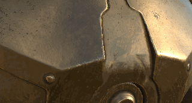

# 投影

{width="50px"}

投影は、画面/ビューポートスペースにマテリアルをペイントすることで投影できるツールです。 ステンシルと同様のコントロールが使用できます。

**ショートカット S**&#x200B;を押すと、投影変換を編集できます。

* **Sキーを押しながら左クリック**&#x200B;して、ステンシルを回転させます。
* **S +左クリック+ Shift**&#x200B;を使用して、ステンシルのスナップ/回転を制限します。
* **S +右クリック**&#x200B;して、ステンシルをズーム/ズーム解除します。
* **S +中マウス**&#x200B;を使用して、ステンシルを移動します。

<table>
<tr style="border: 0;">
<td style="border: 0;" valign="top">

</td>
<td style="border: 0;" valign="top">

</td>
<td style="border: 0;" valign="top">

</td>
</tr>
</table>

* **投影** ：画面領域の投影に基づくペイントツール。 このツールは、ビューポート上にパターンを表示し、繰り返します。
* **物理的投影** :パーティクルプリセットに基づく物理プロパティを持つ投影ペイントツール。
