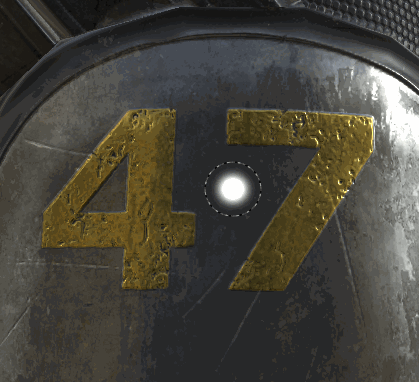

# 指先ツール

Substance 3D Painter 2で導入された指先ツールは、[ペイントツール](https://support.allegorithmic.com/documentation/display/SPDOC/Paint+brush)と同じ種類のパラメーターを共有します。

## 使用状況

指先ツールを使用する最も簡単な方法は、通常のペイントツールとして、ペイントレイヤーのコンテンツに直接使用することです。

指先ツールを効率的に使用するには、ペイントレイヤーを作成し、レイヤーのすべてのチャンネルを「通過」描画モードに設定します。 これにより、「指先レイヤー」の下にあるすべてのレイヤーに対して、非破壊的なぼかしを行うことができます。 下のレイヤーはそのままで、後から適用されるすべての変更は指先レイヤーによって考慮されます。
