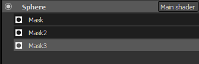

# バージョン2.2

**Substance Painter 2.2**&#x200B;は、動的マテリアルレイヤリングである新しいワークフローを追加します。

リリース日： *21 July 2016*

## 主な機能

### 新しい動的マテリアルレイヤリングワークフロー

この新しいバージョンに、**マテリアルレイヤー**&#x200B;と呼ばれる新しい&#x200B;**ワークフロー**&#x200B;を追加します。 従来のテクスチャリングワークフローでは、**高解像度**&#x200B;で&#x200B;**詳細を保持**&#x200B;するテクスチャを作成する必要がありますが、ユースケースについては&#x200B;**不便**&#x200B;です。 より興味深いアプローチは、**小さな耕耘用のマテリアル**&#x200B;を作成し、**シェーダー内でそれらを繰り返す**&#x200B;ことです。 この機能を使用すると、特定の画質を維持し、このシェーダー **を使用してオブジェクトに**&#x200B;ズームして本当に近づく&#x200B;**ことができます。ディテールが失われることはありません**。 唯一の問題は、最終結果をプレビューするために、以前は最終的なシェーダーを表示するゲームエンジン/レンダラーに移動する必要があったことです。 この新しいバージョンでは、Substance Painter内で同様のシェーダーを使用できるようになりました。これにより、**最終結果とペイントを同時に視覚化**&#x200B;できます。

「**FireHydrant**」という名前の&#x200B;**新しいサンプルプロジェクト**&#x200B;が、新しいワークフローを紹介するために追加されました。

この新しいワークフローでは、次の2つの方法を使用できます。

* マテリアルはシェーダー内で定義されます。ペイントマスクでのみブレンドできます
* マテリアルとマスクは一緒にペイントできる

いずれの場合も、毎回、新しいレイヤースタックを定義することで、マスクやマテリアルを作成する際の自由度を高めることができます。 これにより、レイヤーの管理がはるかに簡単になり、各スタックは、最終的なシェーダーにブレンドできる固有のチャンネルのセットを持つことができます。\
ShareにはUnity 5とUnreal エンジン 4の特別なシェーダーもあります。

* [Unity 5](https://share.allegorithmic.com/libraries/2126)
* [アンリアルエンジン 4](https://share.allegorithmic.com/libraries/2125)

詳細については、ドキュメントの専用ページを参照してください： [動的マテリアルレイヤリング](../../features/dynamic-material-layering.md)

### 新しいミニシェルフ検索フィールド

アプリケーションの様々な場所に表示される&#x200B;**ミニシェルフ**&#x200B;を、専用の検索フィールドで改善しました。 この改善により、リソースの検索がより便利で使いやすいものになります。 カスタム検索は、アプリケーションの現在のセッション中も保持されます。 例えば、多くのノイズを使用する場合、このキーワードを使用すると

## チュートリアル

最新のビデオチュートリアルでは、次の新機能について説明しています。

## リリースノート

### 2.2.0

（2016年7月21日リリース）

**追加：**

* [シェルフ]検索システムとクエリの改善
* [シェルフ]ミニシェルフの検索フィールドを追加する
* [シェーダー]スライダーのステップ精度を定義できます
* [シェーダー] シェーダーパラメーターに「取り消し」ボタンまたは「やり直し」ボタンを追加します
* [シェーダー] シェーダーを再読み込みしても、パラメーターはリセットされません
* [MatLayering] 動的マテリアルレイヤリングとサブスタックのサポートを追加
* [MatLayering] JSONファイルを読み込んでシェーダー設定を行えるようにします
* [MatLayering] テクスチャサンプラーの制限を解除（バインレステクスチャに切り替え）
* [スクリプティング] ベイカーの設定と計算の起動を許可する
* [Substance] 識別子に加えて、入力/出力コネクションにも「使用法」を使用します
* [ツール]投影ツールのビューポートでプレビューチャンネルを選択できるようにします

**修正済み：**

* 物質が間違ったフォルダーに配置されている場合の起動時のクラッシュ
* ログファイルが正しくないために、クラッシュレポートが機能しない場合があります
* [Iray] Irayが一時停止しているときにポストエフェクトが更新されない
* [Iray]自動フォーカスショートカットが機能しなくなった
* [Iray]アセットサイズに応じてアパーチャスライダーの動作が変わる
* [レイヤー]最初のマテリアルチャンネルがすべて無効になっている場合、初期設定では有効になりません
* [シェーダー] 「param auto」が正しくない場合、エラーは出力されません

**既知の問題：**

* [Mac] テクスチャサンプル数の上限が16でロックされる（GPUドライバーの問題）
