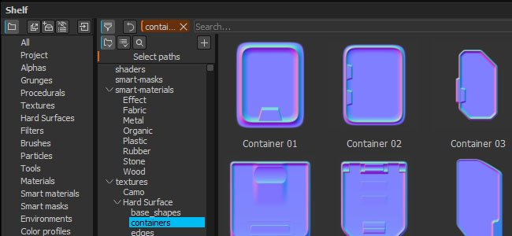
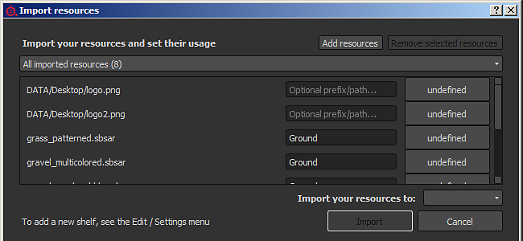
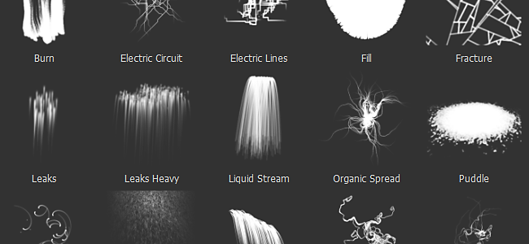

# バージョン2.4

**Substance Painter 2.4**&#x200B;では、シェルフウィンドウの改善とリソース管理の強化に重点が置かれています。

リリース日： *27 October 2016*

## 主な機能

### 詳細フィルタリングを含む新しいシェルフウィンドウ

新しいシェルフウィンドウでは、**新しいフィルタリングコンテンツの使い方**&#x200B;に加え、**整理**&#x200B;のリソースが提供されます。 各プリセットが独自のフィルタリングを持つ&#x200B;**カスタムプリセット**&#x200B;を作成できるようになりました（異なるクエリ間をすばやく切り替えることができます）。 これらのプリセットは、**新しいウィンドウに整理**&#x200B;することもできます。これにより、以前のように1つだけでなく、**複数のビュー**&#x200B;をシェルフで表示できます。 このフィルタリングは、**ディスク上のフォルダの階層を参照**&#x200B;する手段も提供し、より一般的なクエリを調整する場合に便利になります。 また、**コンテキストメニュー**&#x200B;も改善され（リソースを右クリックした場合）、**さらに有用な情報**&#x200B;が提供されるようになりました。

高度なクエリの作成については、ドキュメントの専用部分を参照してください： [高度な検索クエリ](../../interface/assets/advanced-search-queries.md)

### 新しいインポートリソースウィンドウ

リソースの再処理により、**シェルフのインポートウィンドウも改善されました**。 ウィンドウの一貫性が向上し、**呼び出し方法が3通りになりました。**&#x200B;ファイルメニューから、シェルフウィンドウのボタンから、または前と同じように、リソースをシェルフウィンドウにドラッグアンドドロップして呼び出します。 新しいウィンドウでは、**複数のリソース**&#x200B;の使用状況を一度に&#x200B;**すばやく設定**&#x200B;できます。つまり、最初にリソースを適切な場所にドラッグ&amp;ドロップする必要がなくなりました。 また、新しいツリービューを利用するために、**カスタムパスを指定**&#x200B;してサブフォルダを作成する機能も追加されました。

詳細については、ドキュメントの専用部分を参照してください： [インポートウィンドウを使用したリソースの追加](https://helpx.adobe.com/jp/substance-3d/unlisted/documentation/spdoc/adding-content-via-the-import-window-151584824.html)

### 新しいパーティクルプリセット

前の&#x200B;**パーティクルプリセット**&#x200B;を&#x200B;**修正**&#x200B;して、より使いやすい状態にします（特に&#x200B;**雨**&#x200B;プリセット）。 この機会に、新しいビヘイビアーを使用して&#x200B;**新しいプリセットを追加**&#x200B;しました。**電気回路、電線、ロココ、静脈が小さい**&#x200B;様子をご覧ください。

## チュートリアル

新しいシェルフの機能と使用方法については、最新のチュートリアルで説明しています。

## リリースノート

### 2.4.1

（2016年10月28日リリース）

**修正済み：**

* テンプレートを使用したプロジェクトの作成時にクラッシュが発生する
* 書き出し中に書き出しダイアログを閉じるとクラッシュが発生する
* [Mac]プロジェクトの保存時にエラーが発生する（書き出しプリセットを保存できない）
* [シェルフ]新規プリセットを作成すると、2回表示される
* [シェルフ]管理者権限がないと、プリセットを読み取り専用モードで読み込めません

### 2.4.0

（2016年10月27日リリース）

**追加：**

* [シェルフ]リソースを参照するための新しいインターフェイス（ツリービュー、フィルタなど）
* [シェルフ]検索をプリセットとして保存できるようにします
* [シェルフ]プリセットから新しいウィンドウを作成できるようにします
* [シェルフ]リソースを読み込むための新しいインターフェイス
* [シェルフ]文書フォルダー内のデフォルトのアレルギーシェルフをコピーしない
* [シェルフ]新しいパーティクルプリセット: Electric Circuit、Electric Lines、Rococo、Veins Small
* [シェルフ]古いパーティクルのプリセットが改善され、使いやすくなりました（「雨」など）。
* [シェルフ]リソースコンテキストメニューに新しい情報を追加する
* [ビューポート] 環境マップを読み込む際のパフォーマンスの向上
* [ビューポート] 2の累乗ではない環境マップのサポートを追加する

**修正済み：**

* マスクを削除する際のクラッシュ
* プリセットを保存した後にペイントするとクラッシュが発生する
* 一部のGPUで環境ぼかしを使用するとクラッシュが発生する
* ミニシェルフで間違ったリソースを割り当てるとクラッシュが発生します
* [シェルフ]プロジェクト内のリソースのタグとメタデータを消去して保存
* [シェルフ]プリセットを読み込むと、シェルフにリソースが表示される
* [書き出し] Heightチャンネルから生成された法線マップの照度が低い
* [書き出し] メッシュからの法線が最終法線マップに常に存在するとは限らない
* [書き出し]透明部分のある拡張で透明部分が表示されないことがある
* [スクリプティング] 「alg.plugin\_root\_directory」は、切り捨てられたネットワークパスを返すことがあります
* 非正方形プロジェクトを再度開くと、「テクスチャセット」ロックボタンが有効になる
