# バージョン7.4

**Substance 3D Painter 7.4**&#x200B;では、新しいカラーマネジメントワークフローにより、OpenColorIOのサポートが追加されました。

リリース日： *24 November 2021*

## 主な機能

### 新しいカラーマネジメント

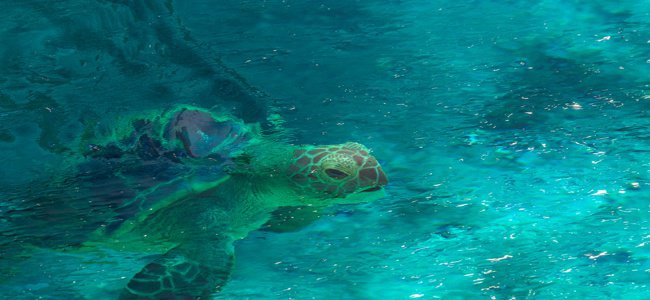

このバージョンでは、[OpenColorIO](https://opencolorio.org/) （OCIO略語）バージョン2のサポートによるカラーマネジメントが導入されています。

この新しいワークフローにより、読み込みから書き出しまで、またアプリケーション内でもカラーを管理および調整できるため、異なるビューポート間で任意のコンテンツをより簡単に一致させることができます。

* **プロジェクト設定**\
  新規プロジェクトの作成時に、カラーマネジメントを有効にできるようになりました。 既存のプロジェクトでは、プロジェクト設定を使用してカラーマネジメントを有効にすることもできます。\
  カラーマネジメントを有効にするには、**従来** （デフォルト）から&#x200B;**OpenColorIO**&#x200B;に切り替え、デフォルトの構成またはカスタムの構成のいずれかを使用します。

  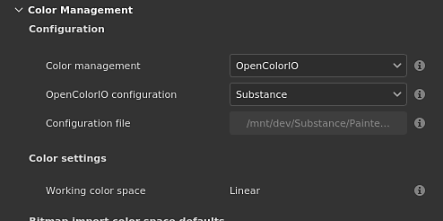{width="400px"}

* **ビューポートの表示設定**\
  2Dビューと3Dビューの上部には、カラーマネジメント用の2つのコントロールがあります。\
  **色のボタン**: ビューポートの色変換を有効または無効にします。\
  **表示変形ドロップダウン**：色の変換に使用する表示変形を選択します。

  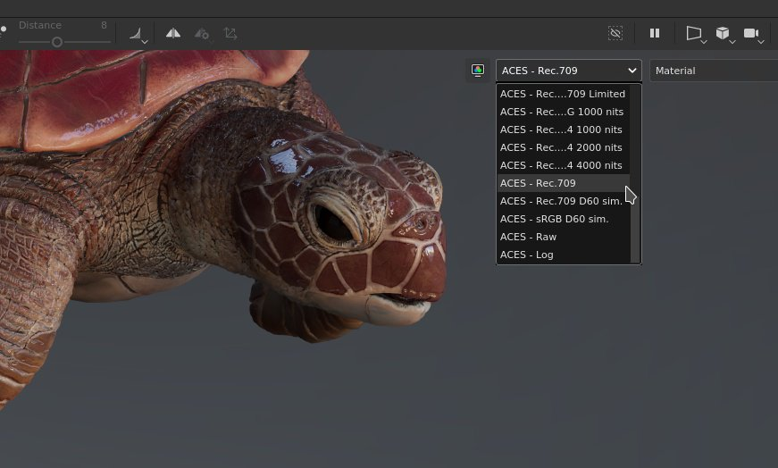{width="500px"}

* **カラーピッカーの設定**\
  カラーマネジメントが有効になっている場合、カラーピッカーには新しいコントロールが表示されます。 カラーは、設定で指定された作業用カラースペースで編集されます。\
  HSV/RGBスライダの下には、作業スペースから表示カラースペースに変形した最終的なカラー値が表示されます。

  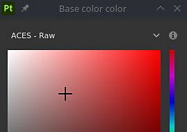

  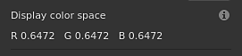

* **カスタムカラースペースを使用したビットマップとマテリアルの読み込み**\
  マテリアルの出力の解釈など、リソースの処理方法を指定するための専用設定が利用できます。\
  ファイル名を解析することで、リソースがどのカラースペースを使用しているかを知ることもできます。

  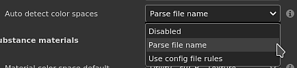

* **設定の書き出し**\
  テクスチャを書き出すと、カラーマネジメントされたチャンネルのファイル名に、新しいキーワード&#x200B;**$colorSpace**&#x200B;で使用したカラースペースの名前が表示されます。

  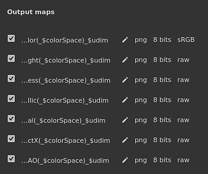{width="250px"}

  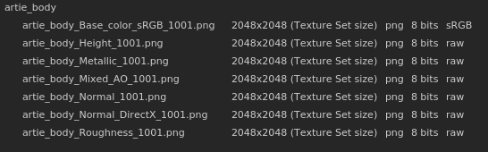

>[!NOTE]
>
> アプリケーション内でのカラーマネジメントの仕組みについて詳しくは、[専用ページ](../../features/color-management/color-management.md)を参照してください。

### 2Dおよび3D ビューポートの新規ドッキング解除

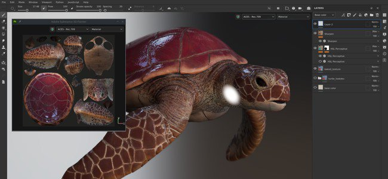

2Dおよび3Dビューをドッキング解除して、他の場所に移動できるようになりました。 例えば、2D ビューを別の画面に表示した状態で、3Dビューをメイン画面に表示できます。

ドッキングされていないビューを使用すると、アプリケーションのレイアウトを整理したり、ペイント領域を広げすぎることなくオブジェクトに注意を向けたりすることが容易になります。

* **ビューのドッキングを解除する**\
  ビューのドッキングを解除するには、ビューメニューを開き、2つのオプションのいずれかを選択します。 各オプションでは、新しいウィンドウが開き、そのビューが内側に表示されます。もう1つのビューはメインインターフェイス内にドッキングされたままになります。

  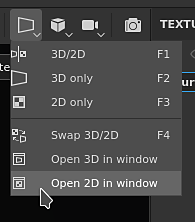

* **ドッキングされていないビューでも入れ替える**\
  ビューのドッキングが解除されている間は、表示メニューのスワップアクションを使用して交換できます。

  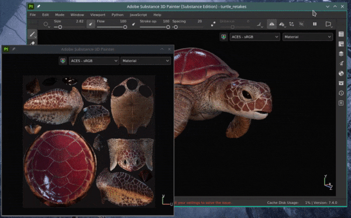{width="500px"}

* **カラーマネジメントと互換性があります**\
  ドッキングされていないビューには独自のカラーマネジメント表示変形があり、異なるモニターでの管理が容易になります。

  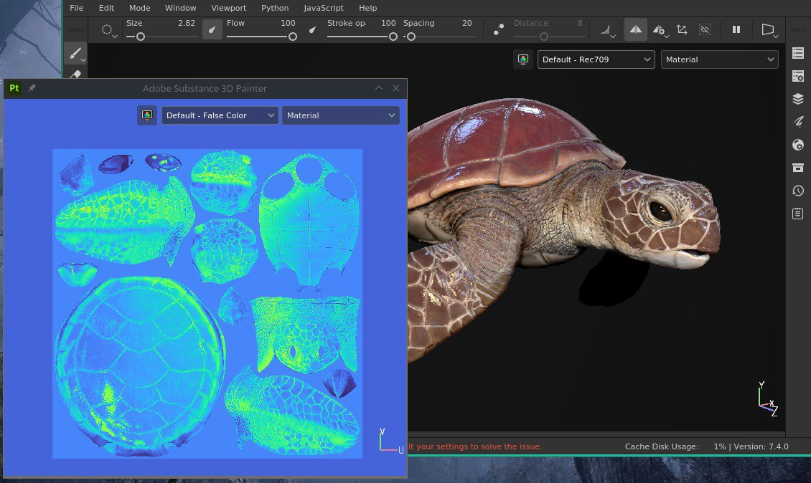{width="500px"}

### 3DconnectionによるSpaceMouse®の新しいサポート

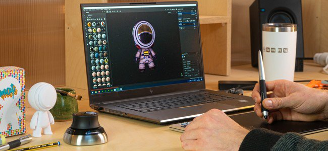

**SpaceMouse®**&#x200B;は、3D ビューポートカメラをより直感的で使いやすい方法で操作できる3Dconnectionによるデバイスです。 このリリースでは、Painterを使用してネイティブかつ直接プラグアンドプレイできるようになりました。

詳細については、専用の[ドキュメントページ](../../features/spacemouse-by-3dconnexion.md)を参照してください。

>[!NOTE]
>
> * バージョン7.4.2以降で利用可能です。
> * Painterの制御方式を利用するには、最新のSpaceMouse®ドライバをインストールしてください。

### 新規コンテンツ

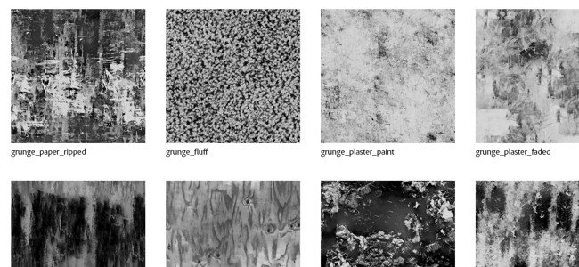

アプリケーションで使用可能なデフォルトのコンテンツに、新しいアセットのセットが追加されました。

* 新しいデカール、ツールプリセット、フィルター（**Käy Vriend**&#x200B;による） :
  * **デカール**
    * 単純瘢痕
    * ポケットパッチレギュラー
  * **プリセット**
    * ジッパー詳細テープ
    * ジッパーの拡張停止
    * ジッパーの詳細スライダー
    * 締め付けコードレース
    * 引き締め付け用コード付きアイレット
    * グリッタースターズゴールデン
    * 派手なパーティー
    * パステル画（ドット）
  * **Generator**
    * 縮小/折り返しを膨張

* 新しい経年劣化ビットマップ（**エミールセレガー**&#x200B;による）:
  * 経年劣化プラスターペイント
  * 色あせた経年劣化プラスター
  * 皮をむいたペイント
  * 経年劣化湿度
  * 経年劣化綿毛
  * 経年劣化くもの
  * 経年劣化ブッシュ
  * ソフトな経年劣化ウッド
  * 経年劣化用紙が裂けている
  * 深裂経年劣化
  * 経年劣化ブラシDust

### 自動ラップ解除機能の向上

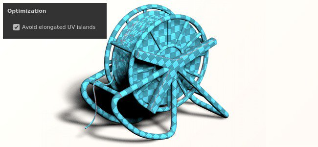

自動ラップ解除が更新され、拡張サーフェスを使用した3Dモデルのサポートを改善する新しいオプションが追加されました。

この新しい設定&#x200B;**長すぎる可能性があるUV アイランドを分割することで、UV領域をより有効に活用する**&#x200B;という名前のUV アイランドが追加されました。

以下に、この新しい設定を使用せずに使用した場合と使用せずに使用した場合の例を示します。

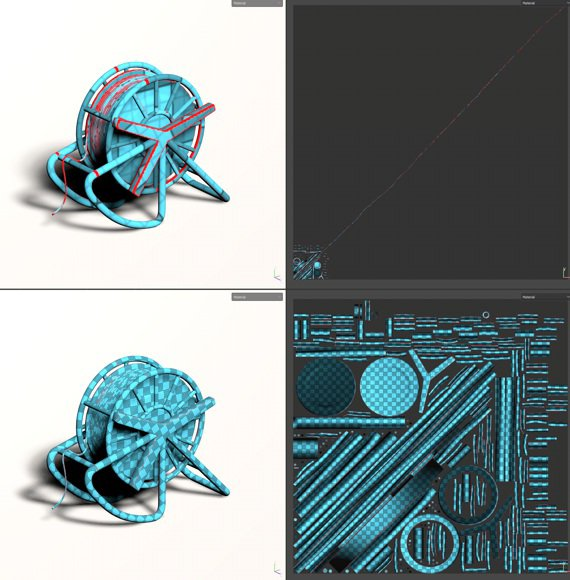{width="500px"}

### 改善されたPythonスクリプティング

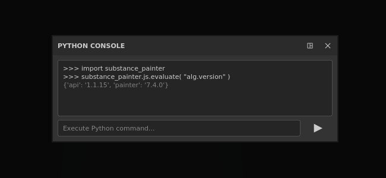

Python APIには、Javascript APIを呼び出すことができる新しいメソッドがあります。

この新しいメソッドを使用すると、古いプラグインを新しいPython APIに簡単に移行できます。 また、Pythonでまだ表示されていない&#x200B;**ベイク処理**&#x200B;および&#x200B;**シェーダー**&#x200B;管理などの機能もロック解除されます。

PythonからJavascriptコマンドを実行するには、新しい&#x200B;**js**&#x200B;サブモジュールから&#x200B;**evaluate()**&#x200B;関数を使用します。 詳しくは、APIドキュメントを参照してください（アプリケーションのヘルプメニューから入手可能）。

## リリースノート

### 7.4.2

*（2022年3月8日公開）*

**追加：**

* [SpaceMouse][Windows]ナビゲーション用の3D ビューポートでの3Dconnection SpaceMouseのサポート
* [SpaceMouse][Windows] 3D ビューポートのProおよびEnterprise SpaceMouseモデルの基本的なショートカットとキー
* [SpaceMouse][Windows] 3D ビューポートの専用回転中心アイコン
* [カラーマネジメント] OCIO設定の役割を使用してデフォルト設定を変更する
* [カラーマネジメント]カラーウィジェットのプロパティウィンドウのカラーマネジメント
* [カラーマネジメント]カラーマネジメントは、マテリアルプレビューのプロパティウィンドウを管理します
* [カラーマネジメント]カラーピッカーのカラーマネジメントスウォッチ
* [カラーマネジメント]標準のsRGBカラースペースを定義する設定を追加します
* [カラーマネジメント]カラーピッカーの表示セレクターリストで、OCIO設定から標準のsRGBカラースペースを追加します
* [カラーマネジメント]カラースペース上書きメニューの改善
* [カラーマネジメント] [表示設定]の環境マップカラースペースを上書きできるようにします
* [カラーマネジメント]現在の表示に基づいてカラーピッカーグラデーションを描画します
* [カラーマネジメント]カラーエディタでデフォルトでHDR 値をクランプする
* [カラーマネジメント]レガシーモードのフィルターにパススルーを使用（カラースペースなし）
* [カラーマネジメント]カラーエディターのグラデーション表示を[0 ～ 1]の範囲に一致するように制限します
* [カラーマネジメント]レガシーモードのカラーピッカーで表示セレクターを非表示にする
* [カラーマネジメント]カラーピッカーの16進フィールドを常にsRGBカラースペースで作成します
* [カラーマネジメント]データチャンネルのカラーピッカー表示ドロップダウンを無効にする
* [最適化]ワープグリッドは、カバーされたUVタイルのみを再計算します
* [書き出し] Sketchfab、USD、およびglTFのUV タイルプロジェクトを書き出すことができます
* [Scripting][Python] tonemapping関数を変更できます

**修正済み：**

* [Sketchfab]既存のモデルを更新すると新しいモデルが作成される
* [Sketchfab]以前に更新されたモデルを検索するとクラッシュが発生する
* USDへの書き出し時のクラッシュ
* ジオメトリマスクで新しいシェーダーインスタンスを作成するとき、またはジオメトリが非表示のときにクラッシュが発生する。
* [アセットの読み込みウィンドウ]読み込まれたリソースの種類を変更するとクラッシュが発生する
* 法線のメッシュマップは、レイヤースタックで使用すると反転します
* [Substance]ユーザーデータ描画モードが考慮されない
* [カラーマネジメント]ファイル名にカラースペースが含まれているビットマップは、UV タイルシーケンスとして読み込まれます
* [カラーマネジメント] グラフのカラーマネジメントされた出力が間違ったカラースペースにあります
* [カラーマネジメント]ポリゴン塗りつぶしツールが間違ったカラーを表示する
* [カラーマネジメント] ACEのトーンマッパーをソロモードのチャンネルに適用する
* [カラーマネジメント]ツールプレビューの球体照明がカラーマネジメントされない
* [カラーマネジメント][書き出し]変換されたマップが正しく変換されない
* [Scripting][Python][Color Management] templateおよびOCIO環境変数を使用して作成されたプロジェクトはレガシーモードです
* [Scripting][Python]起動時にJavaScriptのevaluate関数を使用できない
* [3D Adobeプラン]デフォルトでサポートされていない言語で地域の設定を使用すると、Painterを起動できない

**既知の問題：**

* 3Dconnection SpaceMouseはMacOSではサポートされていません
* [UI]水平スクロールバーとカラーマネジメントが、新しいプロジェクトウィンドウに表示されることがある
* [ベイカー] 「平均法線」設定はUV タイルプロジェクトには影響しません
* [Mac M1] スマートマテリアルが正しく表示されない
* [カラーマネジメント] 投影モードで使用されているリソースがオーバーレイでカラーマネジメントされない

### 7.4.1

*（2021年12月14日公開）*

**追加：**

* [カラーマネジメント]書き出したファイル名にデータの役割を使用する
* [カラーマネジメント]新しいプロジェクトおよびプロジェクト設定ウィンドウで「OCIO」が選択されている場合、デフォルトで「カラーマネジメント」セクションを展開します
* [カラーマネジメント]レガシーモードでACEのトーンマッパーを追加する
* [カラーマネジメント]デフォルトの構成設定の調整
* [カラーマネジメント][書き出し]データチャンネルのファイル名で$colorSpaceを塗りつぶします
* [書き出し] UV タイルプロジェクトをStagerに書き出す
* [相互運用性] SteamおよびSubstanceエディションでは使用できません
* [相互運用性] UV タイルプロジェクトをStagerに送信できるようにします

**修正済み：**

* [MacOS][クラッシュ] PainterがCatalinaで始まらない
* [カラーマネジメント][クラッシュ]ユーザチャンネルでデータタイプ/カラーマネジメントを使用すると、ランダムなクラッシュが発生する
* [カラーマネジメント]マスク表示カラースペースの新規メニューでグレースケールとして使用されるリソース
* [カラーマネジメント]従来のモードとソロ表示でビューポートのユーザーチャンネルが暗くなる
* [カラーマネジメント] iRayで使用する場合、環境マップは常にリニアです
* [カラーマネジメント]レガシーモードのデータチャンネルで、カラーピッカーが適切な値を選択しない
* [カラーマネジメント]レガシーモードで、カラーピッカーがSubstance内で壊れている
* [カラーマネジメント]ドロップダウンメニューを使用したときに、ビューポートのソロチャンネル表示を切り替えると、適切なカラースペースが表示される
* [カラーマネジメント]従来のモードのカラーマネジメントされたユーザーチャンネルで「書き出し」を実行すると、正しく変換されない
* マテリアル表示に戻すと、単独の表示マスクで作成したストロークが表示されない
* [書き出し]変換されたマップが、カラーマネジメントされたチャンネルとして書き出されない
* [テクスチャセット]名前を変更したユーザチャネルで、元の名前のツールチップが表示されない
* [Steam] Steamでファイルの整合性をチェックするときに、ファイルが見つからない

**既知の問題：**

* [Mac M1] スマートマテリアルが正しく表示されない

### 7.4.0

*（2021年11月24日リリース）*

**追加：**

* [カラーマネジメント]カラーマネジメントOpenColorIOバージョン2のサポート
* [カラーマネジメント]プロジェクト設定へのカラーマネジメント設定の追加
* [カラーマネジメント]プロジェクトを開いたときにカラーマネジメント構成が変更されることに関する警告ウィンドウ
* [カラーマネジメント]無効なOCIO構成ファイルが選択された場合にエラーメッセージを表示する
* [カラーマネジメント] OCIO環境変数を使用して設定を上書きできるようにします
* [カラーマネジメント]デフォルトで複数のOCIO設定がアプリケーションに統合されています。
* [カラーマネジメント]読み込んだビットマップファイル名からカラースペース名を抽出します
* [カラーマネジメント]プロパティウィンドウの設定から1つのカラースペースでカラースペースを上書きできます
* [カラーマネジメント] テクスチャセット設定でカラーマネジメントオプションを追加する
* [カラーマネジメント][ビューポート] 2Dビューと3Dビューを別々にカラーマネジメントできます
* [カラーマネジメント] 環境マップを読み込んで作業用カラースペースに変換する
* [カラーマネジメント]現在のカラースペースでカラーピッカーとエディターを調整
* [カラーマネジメント]新しいドロップダウンメニューで、ビューポートの表示変形のカラースペースを選択できます
* [カラーマネジメント] Irayのレンダリング結果に表示変形を適用
* [カラーマネジメント]異なるカラースペースを使用したテクスチャの書き出し
* [Color Management][Python]新しいプロジェクトに環境変数(OCIO)のカラーマネジメント設定を適用する
* [ビューポート] 2Dまたは3D ビューポートのドッキングを解除できるようにします
* [自動ラップ解除]細長い島を避けるための新しいオプション
* [Pythonスクリプト] Python APIからJavaScript関数を呼び出す
* [新しいプロジェクトウィンドウ]読み込まれたマップのセクションを折りたたみ可能にする
* [投影][ワープ]ワープ設定のオプションとして法線を非表示にできます。
* [コンテンツ] 11個の新しい経年劣化マップ
* 【内容】新ツールプリセット 8点（ジッパー、コード引き締め、グリッター）
* [内容] 8つの新しいマテリアル（傷跡、ポケット、...）
* [コンテンツ] 1つの新しいジェネレータ（収縮ワープを膨張）

**既知の問題：**

* [Mac M1] スマートマテリアルが正しく表示されない
* [カラーマネジメント][クラッシュ]ユーザチャンネルでデータタイプ/カラーマネジメントを使用すると、ランダムなクラッシュが発生する
* [カラーマネジメント]レガシーモードのデータチャンネルで、カラーピッカーが適切な値を選択しない
* [カラーマネジメント][Iray] ビューポートでカラーマネジメントがアクティブになっているときに、レンダリングをEXRまたはTIFFで保存すると、常にリニア形式で保存される
* [カラーマネジメント]マスクでグレースケールとして使用されているリソースが、間違ったカラースペースメニューを表示する
* [カラーマネジメント][Iray] Irayで使用する場合、環境マップは常にリニアです
* [カラーマネジメント][書き出し]変換されたマップが、カラーマネジメントされたチャンネルとして書き出されない
* [カラーマネジメント][書き出し]ユーザーチャンネルがカラーマネジメントされているか、レガシーモードではない場合、書き出しは無視されます
