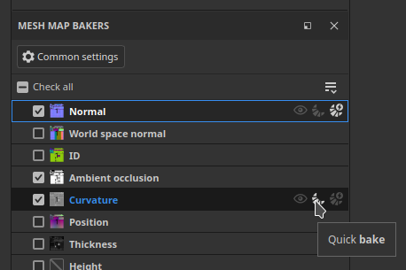
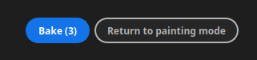
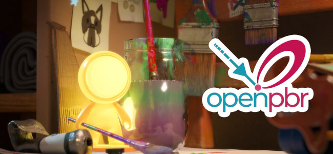
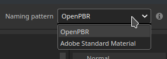
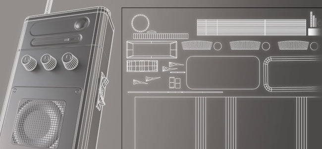
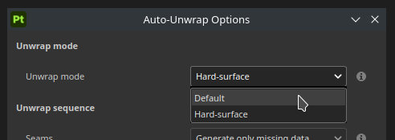
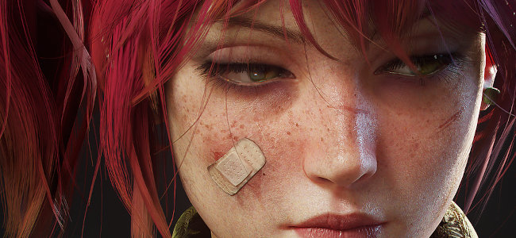
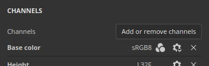
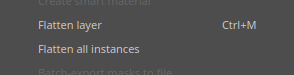
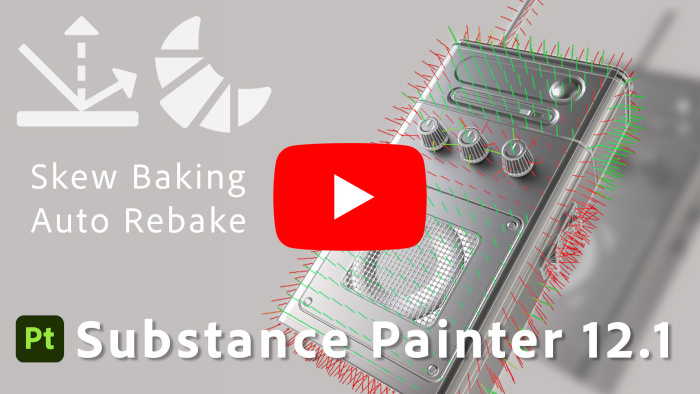

# バージョン 12.1

<b>Substance 3D Painter 12.1</b>では、自動リベイク処理とゆがみ補正ペインティング、UVマテリアル定義のサポート、および自動OpenPBRラップ解除用の新しいハードサーフェスモードにより、ベイクワークフローが改善されています。

リリース日： <b>2026年6月22日</b>

>[!NOTE]
>
> サポートされるmacOSの最小バージョンが13.0(Ventura)に更新されます。 詳しくは、[必要システム構成のページ](../getting-started/system-requirements.md)をご覧ください。

## 主な機能

### 傾斜ペイントによるベイク処理ワークフローの改善

ベイクワークフローが刷新され、継続的な再ベーク、メッシュ上のゆがみ補正ペイント、エッジ保護、および再設計されたメッシュマップリストがサポートされるようになりました。

* <b>自動リベイク処理</b>

  メッシュマップは、ベイクパラメーターを調整しながら連続的に再ベイク処理できるため、変更のたびに手動でベイクをトリガーする必要がなくなります。 自動リベイク処理はマップごとに切り替えられ、一度に1つのマップに適用されます。 これは、スキューのペイントワークフローで特に便利ですが、一般的な烘焙設定を調整する場合にも便利です。

  

* <b>ゆがみ補正ペイント</b>

  ケージを<b>ディスタンスベース</b>モードにすると、ローポリメッシュに直接ゆがみ補正をペイントして、ベイク中に使用される投影方向を制御できます。 ブラシ、消しゴム、および多角形の塗りつぶしツールを使用できます。コンパクトなグレースケール値ピッカー、対称、および通常のブラシコントロールを使用できます（<b>Ctrlキーを押しながら右クリック</b>してブラシのサイズを変更、<b>X</b>してペイントした値を反転）。 ゆがみペイント操作は取り消すことができます。

  

* <b>エッジ保護</b>

  ゆがみ補正でペイントする場合、新しいエッジ保護オプションを使用すると、ハードエッジに投影された高ポリゴンの柔らかさが保持されます。 その結果は、<b>エッジ距離</b>および<b>エッジコントラスト</b>パラメーターによって制御されます。

  

* <b>メッシュマップのデザインを変更しました</b>

  メッシュマップリストでは、マップをビューポートとして切り替える<b>プレビュー</b>、<b>クイックベイク</b>1つのマップとして切り替える、<b>自動リベイク</b>および<b>同期</b>のテクスチャセット間で切り替える（プロジェクトに複数のテクスチャセットがある場合に利用可能）、マップ単位のコントロールが提供されます。 各コントロールには、カーソルを合わせたときにツールチップが表示されます。

  

* <b>[簡易ベイク]ボタン</b>

  [ビューポートのベイク]ボタンは、ベイクするマップの数（テクスチャセット x UV タイル x選択したメッシュマップ）を表示する1つの<b>ベイク</b>ボタンに置き換えられました。

  

>[!NOTE]
>
> ベイクの詳細については、[専用ドキュメントページ](../baking/baking.md)を参照してください。

### OpenPBR のサポート

シェーディングモデルがPainterでサポートされるようになり、デフォルトワークフローとして使用されるようになりました。これにより、標準化されたマテリアル定義をアプリケーション間で伝送できます。

* <b>新しいOpenPBR シェーダーと既定のワークフロー</b>

  シェーダー 1.1仕様を実装するOpenPBRがデフォルトで使用可能になり、使用されます。 テンプレートなしで作成された新しいプロジェクトではOpenPBR シェーダーが使用され、新しいプロジェクトウィンドウの最初のエントリには、<b>ASM</b>ではなく<b>OpenPBR</b>というラベルが付けられます。 OpenPBR用の新しいプロジェクトテンプレートが含まれ、サンプルプロジェクトが更新されて使用されます。

  

* <b>インポート時にプロジェクトテンプレートからシェーダーが選択されました</b>

  USDまたはGLTFファイルを読み込むときに、シェーダーがファイルの内容から推測されるのではなく、プロジェクトテンプレートから設定されるようになりました。 マテリアルとテンプレートで不一致ワークフローが使用されている場合は、ログにメッセージが記録されます。

  

* <b>エクスポートに関するOpenPBR名前付け規則</b>

  <b>書き出しテクスチャ</b>ウィンドウに、命名規則を選択するための新しいドロップダウンが追加されました。 プロジェクト内の少なくとも1つのOpenPBRが使用されると、既定のシェーダーになり、選択したスキームが各テクスチャセットのマップの一覧に反映されます。

  

* <b>USDとMDLのサポート</b>

  マテリアルは、USDフォーマットでサポートされています。 新しいMDLも追加され、IrayのOpenPBRマテリアルをレンダリングして、より正確なマテリアル表現を提供できるようになりました。

>[!NOTE]
>
> カスタムシェーダを更新する必要がある場合があります。 シェーダー APIがサポートOpenPBRに変更されました。詳細については、アプリケーションのヘルプメニューにあるchangelogを参照してください。

### 新しいハードサーフェスの自動ラップ解除

ハードサーフェスアセットに合わせてカスタマイズされた新しい自動ラップ解除モードが追加されました。

* <b>ハードサーフェスラップ解除モード</b>

  自動ラップ解除の設定で、<b>ハードサーフェス</b>オプションを使用できます。 これによりUVのゆがみが最小限に抑えられ、UVレイアウトが直交投影で作成されるため、機械やハードサーフェスのメッシュにより適しています。

  

>[!NOTE]
>
> 自動ラップ解除の詳細については、[専用ドキュメントページ](../features/automatic-uv-unwrapping.md)を参照してください。

### その他

このバージョンでは、追加機能と機能強化が追加されています。

* <b>複数のチャンネルを一度に追加または削除</b>

  OpenPBRの導入後、<b>テクスチャセット設定</b>からアクセスできる新しいウィンドウでは、複数のチャンネルを一度に選択できます。これは、OpenPBRワークフローで使用する大きなチャンネル一覧を設定する場合に便利です。

  * 新しいウィンドウには、テクスチャセット設定の[<b>チャンネルの追加と削除</b>]ボタンからアクセスできます。

    

  * ウィンドウには、Painterで使用できるすべてのチャンネルの概要が表示されます。

    

  * <b>すべてのテクスチャセットに適用</b>ボタンを使用すると、すべてのテクスチャセットのチャンネル構成を一度に編集できます。

    

* <b>複数のテクスチャセット間ですべてのインスタンスを統合する</b>

  新しい<b>すべてのインスタンスを統合</b>オプションは、インスタンス化されたレイヤーおよびグループで使用できます。 インスタンスが表示されるすべてのテクスチャセットにわたって統合された結果が生成され、インスタンスツリー全体に表示されます。この結果は、1回の取り消し手順として記録されます。

  

* <b>元に戻す操作の統合履歴</b>

  ベイクモードとペイントモードで同じ取り消し履歴が共有されるようになりました。 ベイクモードとペイントモードの切り替えは、取り消し可能な手順として記録されるため、操作が発生したモードでのみ操作を取り消すことができます。

## チュートリアル

Youtubeの最新チュートリアルをご覧ください。

## リリースノート

### 12.1.5

リリース日： **2026/09/15**

概要： **マイナーリリース**

**修正済み：**

* シェルフからネットワークへのイメージの書き出しが機能しない
* [Generator] 「テクスチャを使用」をfalseに設定しても、テクスチャ入力の使用は無効になりません
* 3d 投影の編集中にビューポートがフリーズする
* マテリアルレイヤーの解像度が低すぎます

### 12.1.4

リリース日： **2026/09/04**

概要： **マイナーリリース**

**修正済み：**

* ファイル名に非ASCII文字が含まれているファイルをインポートまたはエクスポートするときの[クラッシュ]のクラッシュ

### 12.1.3

リリース日： **2026/08/25**

概要： **マイナーリリース**

**追加：**

* エンジンをバージョン9.4.6vにアップデートする

**修正済み：**

* [グレースケールピッカー]ツールを変更した後もピッカーを開いたままにする
* [ゆがみベイク]ゆがみ補正が壊れて、ペイントしたり取り消したりしています
* [投影ツール]ビューポートの操作は投影ツールによってブロックされています
* [ダイナミックストローク]のブラシプロパティにダイナミックストロークパラメーターがありません
* ネットワークへの書き出しが機能しない

### 12.1.2

リリース日： **2026/08/03**

概要： **マイナーリリース**

**修正済み：**

* \[クラッシュ\]Substanceによっては、レンダリング時にクラッシュが発生することがあります
* \[クラッシュ\]ベイクモードでメッシュを再読み込みします
* \[クラッシュ\]グラフィック表示の初期化に失敗すると、クラッシュが発生する可能性があります
* \[クラッシュ\]ログの更新中にテクスチャのエクスポートがクラッシュすることがある
* \[クラッシュ\] 環境マップの読み込み/更新時にベイクモードでクラッシュが発生する場合がある
* \[ベイク処理\]高ポリゴンファイルを変更した後で烘焙を再起動すると、フリーズする場合があります
* \[Photoshopに送信\]レイヤーのマスクを書き出せない
* \[エンジン\]アンカーポイントの結果が、マスクとカラーチャンネル間でレンダリングされない

### 12.1.1

リリース日： <b>2026/07/09</b>

概要：マイナーリリース

追加：

* [スキューベイク]スキューの基準法線モードを表示: メッシュまたは三角形ごと
* [プロパティ]均一カラーは常にチャンネルの既定値にリセットされます
* [OpenPBR] 出力テンプレートを作成するために、書き出しテクスチャウィンドウでカテゴリ別にチャンネルを再編成します
* エンジンをバージョン9.4.5にアップデートする

修正：

* [プロジェクト]一部のプロジェクトを開いたり保存したりするのに、通常より時間がかかる場合があります
* [クラッシュ]複数のメッシュを再読み込みすると、クラッシュが発生する可能性があります
* [クラッシュ]マスクビューモードでチャンネルを削除すると、クラッシュが発生する
* [クラッシュ]一部のSubstanceは、レンダリング時にクラッシュが発生する可能性があります
* [ペイントのゆがみ]ペイントモードに切り替えても、ペイントのゆがみ内の選択したツールが選択されたままになる
* [共通の設定のベイク] ケージの距離の設定で、ケージのシェーダーとワイヤーフレーム視覚化機能が更新されない
* [エンジン] UVパディングの「3Dスペース近隣」モードが細い三角形で適切に機能しません
* [エンジン]アンカーポイントの結果が、マスクとカラーチャンネルの間でレンダリングされません

### 12.1.0

リリース日： <b>2026/06/23</b>

概要： <b>このアップデートはメジャーリリースであり、新しいベイク処理の既定のUIステート、スキュー地図のペイント、自動リベイク処理、ハードサーフェスメッシュおよびOpenPBRの自動UVラップ解除の新しいオプションを含むベイカーの機能強化が含まれています。 詳細については、完全なリリースノートを参照してください。</b>

<b>追加済み</b>:

* [スキューベイク]スキュー描画ツール
* [スキューベイク]スキューマップをペイントするときに、スキューのプレビューシェーダーとスキュー方向ベクタービジュアルを追加する
* [スキューベイク]エッジ保護オプションを追加
* [スキューベイク処理]自動リベイク
* [スキューベイク] メッシュマップリストのUIをリワークする
* [スキューベイク] メッシュマップを分割/共通ベイク設定+共通設定をメッシュマップリストから移動ベースカラーまたはマスクのみ
* [スキューベイク] ビューポートのツールバーボタンを変更する
* [スキューベイク]ブラシの対称切り替えを上部ツールバーに表示
* [スキューベイク] メッシュマップリストの「同期」メニューの「オプション名を変更」
* [スキューベイク]同期ダイアログとチェック済みステートダイアログを更新
* [スキューベイク]グレースケールカラーピッカーバリアントを作成
* [スキューベイク]ベイクモードアイコンを更新
* [自動ラップ解除] [ハードサーフェスを統合]オプション
* [OpenPBR] OpenPBR 1.1のサポートを追加する
* [OpenPBR] OpenPBRを既定のワークフローおよびシェーダーにする
* [OpenPBR] USD経由でOpenPBRマテリアルとテクスチャを読み込む
* [OpenPBR] USDを介したOpenPBRマテリアルとテクスチャの書き出し
* [OpenPBR] OpenPBRの命名規則を表示するために、書き出しテクスチャウィンドウを更新します
* [OpenPBR]サポートOpenPBRの変更点に関するドキュメントを追加する
* [OpenPBR][Iray] Iray内のOpenPBR 1.1をサポートする新しいMDLを追加
* USDの書き出しに関するいくつかのマイナーな改善
* [UI]別のテクスチャセットーにペイントしようとすると、ビューポートに警告が表示される
* [平坦化]インスタンス化されたすべてのレイヤをテクスチャセット間で平坦化します
* [テクスチャセットの設定]新しいウィンドウで複数のチャンネルを一度に選択できます
* [履歴] 「値」を更新するエントリの文言を元に戻してパラメーター名を反映させる
* [レイヤースタック]マスクの塗りつぶし効果のデフォルトを白(1.0)にする
* [Substance]新しい「メッシュ_ハード_エッジ_トライアングル」エンジンマップ入力を追加
* [Substance]新しい「メッシュ_ハード_エッジ」エンジンマップ入力を追加
* [シェーダー] シェーダーインスタンスが同じ名前を使用できないようにする
* [シェーダー] USDファイルまたはGLTFファイルを読み込むときに、プロジェクトテンプレートのシェーダーを使用します
* Adobe Color Engineをバージョン7.0にアップデートする
* MacOS Xの最小バージョンを13.0にアップグレード(Ventura)
* [コンテンツ] OpenPBRの新しいプロジェクトテンプレート
* [コンテンツ]新しいOpenPBR シェーダーを使用するようにサンプルプロジェクトを更新する
* [Python]ジオメトリマスクAPIを拡張して、UIのような包含モードと除外モードを許可する

<b>固定</b>:

* [クラッシュ][メッシュマップの設定]設定を他のテクスチャセットに適用します
* [クラッシュ]ワールド空間法線なしでマップから曲率をベイクする場合
* [クラッシュ][ベイク]カスタムケージを有効にしたが、ファイルが選択されていないクラッシュでのベイク
* [クラッシュ] AOベイクをキャンセルしています
* [自動ケージ]高ポリゴンファイルパスが無効な場合の無限荷重
* [Linux][Windows]カラーピッカーが完全に黒くなったり、表示されないことがある
* [ポリゴン塗り潰しツール]ツールがPBR以外では機能しない
* [[ペイント] base colorチャンネルを削除しても、以前にペイントしたカラーが削除されない
* [USD] シェーダーインスタンスがすべて正しく検出されない
* [Substance]入力/出力ノードの最初の使用のみが考慮されます
* [シェーダー]Ambient occlusionを、異なるミキシング法を使用したテクスチャセットで2回適用する
* [エンジン]通常のテクスチャに空のブルーチャンネル（黒）が含まれていると、正しいブレンド結果が得られない可能性があります
* [GLTFの読み込み]すべてのテクスチャセットでアルファブレンディングが有効になります
* [GLTF書き出し]書き出し時にアルファブレンディングが常に有効になる
* [書き出し] GLTFファイルを読み込むときに、両面ジオメトリが常に無効になる
* [Javascript]シェーダ設定の変更が取り消し履歴に影響しない
* [サンプル]表面化散乱がMeet Matの[表示設定]で有効になっていません
