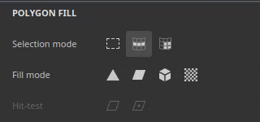
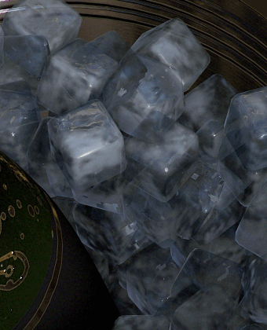

# バージョン 12.2

**Substance 3D Painter 12.2**&#x200B;では、ループベースの選択範囲、ベイク用のケージペイント、ビューポート内のテクスチャセットハイライト、リアルタイムレンダリングのための順序に依存しない透明度を備えた、改善された多角形の塗りつぶしツールが提供されます。

リリース日： **2026年10月21日**

## 主な機能

### 改善された多角形の塗りつぶし

**多角形の塗りつぶし**&#x200B;ツールが、多角形ループの新しいインターフェイスと新しい選択モードで修正されました。 このツールは、不透明度コントロールを備えた描画モードにも対応するようになり、複数のチャンネルで同時に作業できるようになりました。 選択範囲はオクルージョンも処理します。つまり、カメラから隠されているポリゴンは無視されます。

* **改善されたインターフェイス**

  **プロパティ**&#x200B;ウィンドウの&#x200B;**多角形の塗りつぶし**&#x200B;の設定が、使いやすくするために修正されました。 オプションがボタンの列として表示されるようになり、モードの切り替えがより迅速になりました。 新しいツールチップアイコンは、各モードの機能を説明します。

  

* **新しい選択モード**

  **選択モード**&#x200B;の行に、ポリゴンループ専用の2つの新しいモードが追加されました。

  

  * **多角形ループ塗りつぶし**：このモードでは、1回のクリックで四角のループ全体を塗りつぶします。 **Alt**&#x200B;を押しながらドラッグすると、反対方向に選択範囲が拡張されます。

    

  * **部分的な多角形ループの塗りつぶし**：このモードでは、ループの一部のみを塗りつぶし、ループに沿ってドラッグすると選択範囲が拡張されます。 ドラッグ中は、予期しないパスの変更を予測できるように、選択範囲の両側に矢印が表示されます。 カーソルの横のツールチップに、両方の軸で選択したポリゴンの数が表示されます。 **Alt**&#x200B;を押しながらドラッグすると、反対方向に選択範囲が拡張されます。

    

  **Shift + A**&#x200B;を押したままにすると、どの選択モードからも一時的に&#x200B;**多角形ループ塗りつぶし**&#x200B;に切り替わります。 ショートカットをマウスボタンの前に放すと、マウスボタンを放すまで選択が続きます。

* **塗りつぶしモードで選択モードを切り替えます**

  **塗りつぶしモード**&#x200B;のオプションは、**多角形ループの塗りつぶし**&#x200B;および&#x200B;**多角形ループの部分的な塗りつぶし**&#x200B;のモードには適用されません。 このため、塗りつぶしモードを選択すると、**選択モード**&#x200B;が自動的にメインモードに戻ります。

  

* **新しいヒットテストオプション**

  新しい&#x200B;**ヒットテスト**&#x200B;のオプションは、選択範囲に含めるポリゴンを制御します。 非表示のポリゴンを破棄することは現在、既定の動作です。**表示されているポリゴンのみ**&#x200B;オプションは既定で有効になっています。 このオプションを無効にすると、以前のメッシュの塗りつぶし動作に戻ります。

  次のオプションを使用できます。

  * **交点**: （既定）多角形の一部が選択範囲の内側にある場合、またはそのエッジと交差する場合、その多角形は塗りつぶされます。
  * **中心を含む**：多角形は、その中心点が選択範囲の内側にある場合にのみ塗りつぶされます。
  * **表示されているポリゴンのみ**：有効にすると、現在のカメラビューで表示されているポリゴンのみが塗りつぶされます。 そのため、隠された背面のジオメトリは無視されます。

  

* **描画モードと不透明度**

  **多角形の塗りつぶし**&#x200B;ツールは、レイヤースタックで使用可能な描画モードと同じリストですべての描画モードをサポートするようになりました。 たとえば、**覆い焼きリニア (Add)**&#x200B;は、既存のデータを置き換えるのではなく、既存のデータに値を追加します。 これらのモードは、**不透明度**&#x200B;スライダーに加えて、**プロパティ**&#x200B;ウィンドウの新しい&#x200B;**描画**&#x200B;セクションで使用できます。 **マテリアル**&#x200B;モードでは、描画モードは&#x200B;**マテリアル**&#x200B;セクションで有効になっているすべてのチャンネルに適用されます。

  

* **複数のチャンネルを一度に入力する**

  **多角形の塗りつぶし**&#x200B;ツールでシングルチャンネルが使用できなくなりました。 **マテリアル**&#x200B;セクションで有効になっているすべてのチャンネルプロパティを1回の操作で設定および入力できるようになりました。

  

* **対称と互換性があります**

  **多角形ループの塗りつぶし**&#x200B;と&#x200B;**多角形ループの部分的な塗りつぶし**&#x200B;も対称で機能します。 1回のクリックでミラー対称を使用できます（ただし、ラジアル対称の方が信頼性が低い場合があります）。

  

* **前のストロークを再開**

  **前のストロークを再開** ショートカット （**A**&#x200B;を押したままにする）は、**多角形の塗りつぶし**&#x200B;ツールで機能するようになりました。これには、描画モード間や不透明度も含まれます。

  

* **テクスチャセット間でより明確なフィードバック**

  ワイヤーフレームは現在アクティブなテクスチャセットについてのみ表示され、選択範囲を変更すると更新されます。 別のテクスチャセットからジオメトリをホバリングすると、関連するジオメトリを塗りつぶすことができないことを示す禁止カーソルが表示されるようになりました。

  

>[!NOTE]
>
> **多角形の塗りつぶし**&#x200B;ツールについて詳しくは、[専用のドキュメントページ](https://experienceleague.adobe.com/en/docs/substance-3d-painter/using/painting/paint-tools/polygon-fill)を参照してください。

### ベイクモードでの新しいケージペイント

新しい&#x200B;**ケージペイントモード**&#x200B;は、グローバルな距離オフセットの上にペイントできる、ピクセル単位のケージオフセットです。 つまり、メッシュに直接ペイントしてケージを調整できます。 ハイポリメッシュがケージの外部に出る領域は、ローカルでより簡単に修正できます。

* **ケージオフセットの新しいペイント**

  ベイクモードの新しい&#x200B;**ペイントケージ**&#x200B;ボタンが、ケージペイントモードに切り替わりました。 このモードでは、**ペイント**、**消しゴム**、および&#x200B;**多角形の塗りつぶし**&#x200B;のツールを使用して、ローポリメッシュからのケージまでの距離を調整できます。

  

  これは、中間テクスチャをペイントすることで実行されます。 このテクスチャは、ベイク中にケージメッシュ上のオフセットとして使用されます。 これは、**歪曲ペイント**&#x200B;のプロセスに似ています。

  上のツールバーの&#x200B;**強さ**&#x200B;パラメーターは、ストロークによって適用されるオフセット値を設定します。 通常の&#x200B;**サイズ**、**フロー**、**ストロークの不透明度**、**間隔**&#x200B;のコントロールや、**値を反転**&#x200B;のボタンも使用できます。 対称もサポートされています。

  

  

* **多角形の塗りつぶしを使用して、メッシュの部分全体を選択して塗りつぶします**

  **ポリゴン塗りつぶし**&#x200B;ツールでは、部分的または全体的なサブオブジェクトのケージを一度に調整できます。 要素をクリックすると、**ケージ 強さ**&#x200B;スライダーを含むフローティングツールバーが開きます。 このスライダーを使用すると、上部のツールバーで設定した値から、ケージをリアルタイムで拡大または縮小できます。 ペイントされたオフセットがオフセットの上に追加されます。

  

* **ビューポートのケージオフセットを視覚化する**

  ケージペイントモードに切り替えると、ビューポートは新しいビューモードに切り替わります。 このモードでは、オフセットはケージ上に緑色のオーバーレイとして表示されます。 また、ケージは、ベイク処理プロセス中に使用されるケージメッシュを表すように変形されます。

  

  **視覚エフェクトのベイク**&#x200B;パネルで制御できる設定がいくつかあります。**ケージ**&#x200B;セクションでは、**ケージ面**&#x200B;と&#x200B;**ケージワイヤーフレーム**&#x200B;の表示とその不透明度を制御します。 また、**オフセットグリッドの不透明度**&#x200B;と&#x200B;**オフセットシェーディングの強さ**&#x200B;があります。

  

* **コンテキストツールバーの描画モード**

  いくつかの描画モードは、コンテキストツールバー内から直接使用できます。 このスライダーを使用すると、ケージのオフセットをより簡単に調整できます。特に、オフセットの増減に使用できます。

  次のモードを使用できます。

  * **標準**：既存のオフセットをストローク値で置き換えます。
  * **明るくする （最大）**：線の高い値と既存のオフセットを保持します。
  * **覆い焼きリニア （追加）**: （既定）既存のオフセットにストローク値を追加します。

  

  ビューポートの右クリックメニューを使用すると、**ポリゴン塗りつぶし**&#x200B;で他の描画モードを使用できます。

* **ケージとスキューのペインティング用の新しいリセットメニュー**

  スキューとケージペイントモードの両方に、設定をリセットする新しいメニューが追加されました。 次のオプションを使用できます。

  * **ケージ/スキューのパラメーターをリセットします**: UIパラメーターを既定値にリセットします。
  * **すべてのケージ/ゆがみペイントストロークを消去** : ケージやゆがみペイントに使用したテクスチャを消去します。
  * **リセットしてすべてをクリア**: UIのリセットと、ケージ/スキューテクスチャの消去の両方を組み合わせます。

  

>[!NOTE]
>
> ベイクの詳細については、[専用ドキュメントページ](https://experienceleague.adobe.com/en/docs/substance-3d-painter/using/baking/baking)を参照してください。

### ビューポートでハイライト表示される新しいテクスチャセット

新しいハイライト表示機能は、3D ビューポートのどのジオメトリが&#x200B;**テクスチャセット**&#x200B;または&#x200B;**UV タイル**&#x200B;に関連付けられているかを特定するのに役立ちます。

* **テクスチャセットリストからハイライト表示**

  **テクスチャセットリスト**&#x200B;のエントリにカーソルを合わせると、テクスチャセットとUV タイルの両方について、ビューポート内のジオメトリがハイライト表示されるようになりました。 これにより、メッシュのどの部分が各テクスチャセットに属しているかを簡単に確認できます。

  

* **ビューポートからハイライト表示**

  モデルの上に&#x200B;**Ctrl/Cmd + Alt**&#x200B;を押し続けると、カーソルの下のテクスチャセットのジオメトリがハイライト表示されます。 ハイライトは、マウスの左ボタンを押している間やパンしている間は非表示になり、モディファイヤを放すと戻ります。

* **ペイントモードとベイクモードで使用可能**

  ハイライトは、ペイントモードとベイクモードの両方で機能します。 ベイクモードでは、無効になっているテクスチャセットはハイライト表示されるとグレーで表示されます。

### 新しい順序に依存しない透明度

リアルタイムビューポートが、順序に依存しない透明度をサポートするようになりました。 これにより、複数の透明または半透明のサーフェスが重なり合う場合に表示されるソートの斑点とちらつきが除去されます。

* **ディスプレイ設定の新しいオプション**

  **順序に依存しない透明度**&#x200B;オプションは、**表示設定**&#x200B;の&#x200B;**レンダリング設定**&#x200B;セクション内で有効にできます。 パフォーマンスに影響を与えないようにするため、デフォルトでは無効になっています。

  

  新しい設定を有効にする前と後：

  

* **パフォーマンス制御**

  **並べ替え容量**&#x200B;パラメーターは、ピクセル単位で並べ替え可能な透明レイヤーの平均数を制御します。 値を大きくすると、複雑なシーンでは透明度が向上しますが、メモリの使用量が増え、パフォーマンスが低下する可能性があります。 次のオプションを使用できます。

  * **低(1x)**。
  * **中(2x)**。
  * **高(4x)** （既定）
  * **非常に高い（8倍）**
  * **Ultra（16倍）**

### その他の改善

このバージョンでは、追加機能と機能強化が追加されています。

* **ディスプレイ設定の再編成**

  **ディスプレイの設定**&#x200B;ウィンドウのパラメーターが再構成され、並べ替えられたため、パネルが移動しやすくなりました。 現在、設定は&#x200B;**環境の設定**、**環境の設定**、**カメラ**、**レンダリングポストエフェクト**&#x200B;および&#x200B;**視覚エフェクト設定**&#x200B;に分割されています。 ウィンドウの上部に並んだボタンにより、各グループに直接ジャンプできます。

  

* **ブラシストロークとの加算ブレンド**

  ブラシ設定に新しい追加描画モードが追加されました。 このモードでは、ストロークは同じレイヤー内で互いに置き換わらずに、互いに重なって表示されます。 これは、ストローク内のスタンプに限定されません。 この新しいモードでは、カラーを追加したり、値を追加または削除してHeightチャンネルをスカルプトしたりできます。

  

* **新しいUV近隣エンジンマップ**

  新しい`mesh_uv_neighbor`エンジンマップ入力をSubstanceマテリアルとフィルターで使用できます。 これは、シームの反対側を見つけるためのUV移流テクスチャとして機能します。 赤チャンネルと緑チャンネルは、シームを通して隣のピクセルに到達するために使用されるUV移流を格納します。

  これらのテクスチャの詳細については、[専用ドキュメントページ](https://experienceleague.adobe.com/en/docs/substance-3d-painter/using/content/creating-custom-effects/mesh-based-input)を参照してください。

## リリースノート

### 12.2.0

リリース日： **2026/10/21**

概要： **この更新プログラムはメジャーリリースであり、ベイク用の新しいケージペイント機能が追加され、ポリゴンの塗りつぶし機能が強化されています。 詳細については、完全なリリースノートを参照してください。**

**追加：**

* ベイク、ケージペイント
* &lbrack;ケージペイント&amp;rbrack；基本ケージペイント UIを作成
* &lbrack;ケージペイント&amp;rbrack；新しいケージ表示オプション
* &lbrack;ケージペイント&amp;rbrack；編集可能な選択/塗りつぶしツール
* &lbrack;ケージペイント&rbrack;ツールバーにブレンドモードを表示
* &lbrack;ケージペイント&rbrack; HDRスライダUIの変更
* &lbrack;ケージペイント&rbrack;ビジュアライゼーションシェーダー
* &lbrack;ケージペイント&rbrack; スタックのリセットオプション
* 多角形フィルツールの改善
* &amp;lbrack；ポリゴンフィル&rbrack;ポリゴンパッチを追加
* &amp;lbrack；ポリゴンフィル&rbrack;ポリゴンループを追加
* &amp;lbrack；ポリゴンフィル&rbrack; 対称サポート（ループ/パッチ）
* &amp;lbrack；ポリゴンフィル&rbrack;対称エッジプレビュー
* &amp;lbrack；ポリゴンフィル&rbrack;ループと部分ループのある三角形を削除
* &amp;lbrack；ポリゴンフィル&rbrack;アクティブなテクスチャセットのみに表示されるワイヤーフレーム
* &amp;lbrack；ポリゴンフィル&amp;rbrack；クリックできない三角形の赤いエッジハイライト
* &amp;lbrack；ポリゴン塗りつぶし&amp;rbrack；塗りつぶしモードのオプションを無効にしない
* &amp;lbrack；ポリゴンフィル&amp;rbrack；すべてのチャンネルプロパティをポリゴンフィルで設定できるようにします
* &amp;lbrack；ポリゴン塗りつぶし&amp;rbrack；前のストロークを再開は、ポリゴン塗りつぶしで機能します
* &amp;lbrack；ポリゴンフィル&rbrack;アクティブでないテクスチャセット上に禁止カーソルを表示
* &amp;lbrack；ポリゴンフィル&rbrack; ALTインスタントプレビュー
* &amp;lbrack；ポリゴンフィル&rbrack;ポリループへの一時的な切り替え用ショートカット(SHIFT+A)
* &lbrack;ビューポート&rbrack; テクスチャセット/UV タイル選択ハイライトを表示
* &lbrack;ビューポート&rbrack;リアルタイムビューポートでOrder Independent Transparencyのサポートを追加
* &amp;lbrack；ディスプレイ設定&amp;rbrack；ディスプレイ設定を新しいグループに再編成する
* &amp;lbrack；ツール&rbrack;ブラシストロークに加算描画のサポートを追加
* &amp;lbrack；ツール&amp;rbrack；多角形の塗りつぶしで加算ブレンドのサポートを追加
* &lbrack;USD&amp;rbrack；書き出したUSDを不透明度マップと一緒に使用すると、Arnoldですべての透明度がレンダリングされる
* &lbrack;Nvidia&amp;rbrack；最新のNvidiaドライバー(616.56 ～ 617.14)に関する警告の追加
* 新しい「メッシュ_uv_neighbor」エンジンマップ入力を追加
* ベイカーをバージョン3.23.0に更新する
* エンジンをバージョン9.6.1にアップデートする

**修正済み：**

* &lbrack;ベイク処理&rbrack; Ambient occlusion名で背面を無視が機能しない
* &lbrack;ベイク処理&rbrack; &lbrack;AMD&rbrack;デバイスがヘビーハイポリメッシュでベイク処理すると失われる
* &amp;lbrack；パフォーマンス&rbrack; Painter hogs VRAM usage
* &lbrack;ビューポート&rbrack; HDPI画面でプロジェクトを開く際にテクスチャが見つからない
* &lbrack;Tool&rbrack;マスクでペイントすると描画モードがグレー表示になる
* ネットワークへの書き出し後、一時フォルダーが削除されない
* &lbrack;USD&amp;rbrack；書き出されたUSDジオメトリは、UV境界に沿って分割されます。
* &lbrack;USD&amp;rbrack；不正な形式のUSDzをロードするとフリーズする
