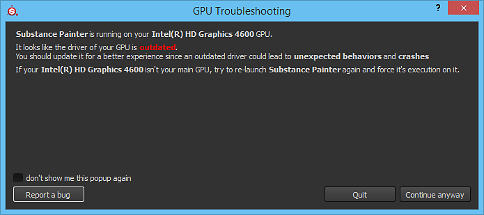

# GPUに古いドライバーがある

{width="500px"}

Substance 3D Painterを起動すると、ポップアップウィンドウにGPUドライバーが古くなっていることが示される場合があります。 このメッセージは、ソフトウェアのインストールにGPUドライバーの最小バージョンが必要であることを意味しています。 最適な操作性を実現するために、GPUドライバーをできるだけ最新バージョンに更新することをお勧めします。

| *仕入先* | *リンク* |
| --- | --- |
| **NVIDIA** | [http://www.nvidia.com/Download/index.aspx](http://www.nvidia.com/Download/index.aspx?lang=en-us) <ul data-preserve-html="true"><li data-preserve-html="true"><strong> GeForce </strong> : 「Studio Drivers」 (SD)のバージョンを推奨します。</li><li data-preserve-html="true"><strong> Quadro </strong> :「Optimal Driver for Enterprise」(ODE)バージョンを推奨します。</li></ul> |
| **AMD** | <http://support.amd.com/en-us/download> |
| **インテル** | <https://downloadcenter.intel.com/> |

>[!NOTE]
>
> 一部のコンピューター<b>には、統合GPU （Intelチップセットなど）と専用GPU （Nvidiaグラフィックスカードなど）の2つのGPUがあります</b>。 Painterでのバグのリスクを最小限に抑えるには、<b>両方</b>が<b>最新</b>である必要があります。
