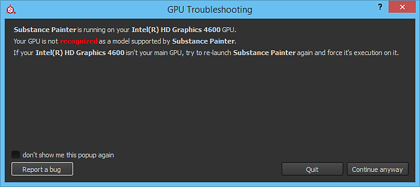

# GPUが認識されない

{width="500px"}

一部の&#x200B;**NVIDIA Optimus**&#x200B;ユーザーは、適切なGPUでSubstance 3D Painterを実行する際に問題が発生することがあります。 回避策は、Windowsのレジストリで次のキーを0に設定することです。

* HKEY\_LOCAL\_MACHINE\SOFTWARE\Microsoft\Windows NT\CurrentVersion\Windows\RequireSignedAppInit
* HKEY\_LOCAL\_MACHINE\SOFTWARE\Wow6432Node\Microsoft\Windows NT\CurrentVersion\Windows\RequireSignedAppInit
