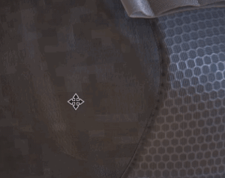

# カメラを動かすとメッシュが白く点滅する

{width="300px"}

古いプロジェクトがビューポートのカメラ中を動き回ると、白い/空のテクスチャによって生じる白いフラッシュが一時的に表示される場合があります。 これは、[スパース仮想テクスチャ](https://substance3d.adobe.com/display/DRAFTPAINTER/Sparse+Virtual+Textures) (SVT)システムが、古いシェーダーでは使用されないシェーダー構成に依存しているためです。

白いフラッシュを取り除くには、**プロジェクトシェーダー**&#x200B;を&#x200B;**更新**&#x200B;するだけです。

* **既定のシェーダー**&#x200B;の場合： [シェーダーの更新](../../../interface/shader-settings/updating-a-shader.md)ページから順を追って手順を実行します。
* **カスタムシェーダー**&#x200B;の場合：ログおよび[シェーダー API](https://helpx.adobe.com/substance-3d/unlisted/documentation/spdoc/custom-shader-api-89686018.html)ページのエラーメッセージを確認してください。
