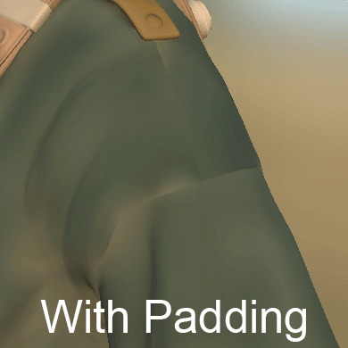

# 拡張またはパディング

**パディング** （**拡張**&#x200B;とも呼ばれる）は、テクスチャの生成後に行われるプロセスです。 このエフェクトは、UV アイランドの境界線を広げて、空の領域を同じようなピクセルで塗りつぶすことを目的としています。

ゲームエンジンまたはオフラインレンダラーで[mipmaps](../../../getting-started/glossary.md)を後で適切に作成するには、適切な品質のパディングを生成することが重要です。\
Substance 3D Painterは無限のパディングを発生させます。つまり、ピクセルは他のUV アイランドまたはテクスチャの境界線に達するまで伸縮します。

## 無限のパディング生成

無限パディングの仕組みの例を次に示します。

<table>
<tr style="border: 0;">
<td style="border: 0;" valign="top">

{width="512px"}

</td>
<td style="border: 0;" valign="top">

</td>
</tr>
</table>

## MipMaps

3Dコンピューターグラフィックスでは、**ミップマップ**&#x200B;は事前に計算され、最適化された一連のテクスチャであり、それぞれが同じ画像の段階的に低い解像度の表現です。 これは、レンダリングの速度を上げ、エイリアシングの斑点を減らすことを目的としています。 カメラに近いオブジェクトには高解像度のミップマップ画像が使用されます。 低解像度の画像は、オブジェクトが遠くに見えるときに使用されます。 この方法を使用すると、元のテクスチャからすべてのピクセルを読み取るか、レンダリングの代わりに効率的にレンダリングすることができます。 ミップマップ（各レベル）は、テクスチャ自体の内部に埋め込まれます（ファイルフォーマットでサポートされている場合）。

低いテクスチャ解像度に変更する場合は、メッシュのUVの内側で裁ち落とされるような不正確なカラーを避けられるため、ミップマップではパディングが非常に重要です。

<table>
<tr style="border: 0;">
<td style="border: 0;" valign="top">

{width="400px"}

</td>
<td style="border: 0;" valign="top">

{width="400px"}

</td>
</tr>
</table>

上の例では、グレーの背景はUV（右画像）に裁ち落とされますが、パディングを使用するとカラーがクリーンに保たれます（左画像）。

3Dアプリケーションでは、次のような結果になります。

## パディングコントロール

Substance 3D Painterでは、パディングの生成を場所に関係なく変更することができます（無効にするなど）。

* **ベイク時** ：詳細については、[ベイクに関するドキュメント](../../../baking/baking.md)を参照してください。
* **テクスチャセットのテクスチャを生成する場合** ：詳細については、[テクスチャセットの設定](../../../interface/texture-set/texture-set-settings.md)のドキュメントを参照してください。
* **テクスチャを書き出す場合** ：詳しくは、[書き出し設定](../../../export/export-window/export-window.md)に関するドキュメントの「Padding settings」セクションを参照してください。
