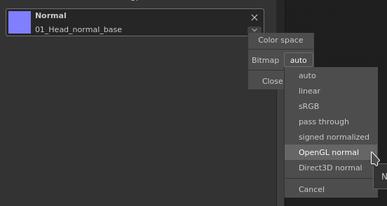

# レイヤーまたはツールプロパティに読み込むと、法線マップが正しく表示されない

現在の塗りつぶしレイヤーツールに法線を読み込むと、それがOpenGL 法線マップである場合は、正しく表示されない場合があります。\
理由は非常に単純です。Substance 3D Painterのエンジンは、読み込まれた法線マップがデフォルトでDirectXであると想定しています。

このビヘイビアーは、substance マテリアルまたは専用チャンネルの横にある小さな矢印をクリックすると簡単に編集できます。

